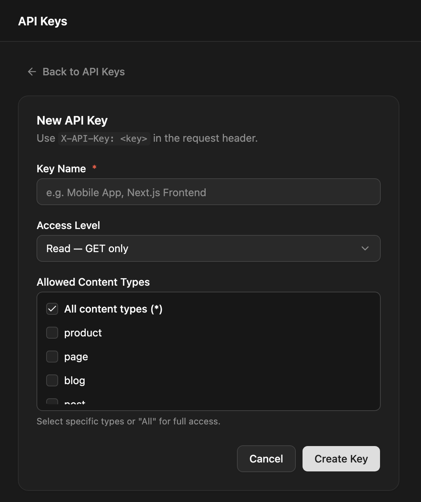

An API key lets an application or script use the API without a user login: a site build that reads drafts, a mobile app that posts entries, a CI job that syncs schemas. You send it in the `X-API-Key` header.

Published content of public content types needs no key at all. Use a key when you need to write, read unpublished content, or use site-wide tooling routes.

Only admins can create and revoke keys.

## Creating a key

1. Open **API Keys** and click **New API Key**.
2. Enter a **Key Name**, such as "Next.js Frontend".
3. Pick an **Access Level** and the **Allowed Content Types**.
4. Click **Create Key** and copy the key.



Keys look like `np_` followed by 48 hex characters. The list shows each key shortened with its access, content types and **Last Used** time, and admins can copy the full key from there.

```bash
curl -X POST https://cms.example.com/api/api-keys \
  -H "Authorization: Bearer $TOKEN" -H "Content-Type: application/json" \
  -d '{ "name": "Next.js Frontend", "permissions": { "access": "read", "contentTypes": ["blog", "pages"] } }'
```

## Access levels

| Access | Can |
|---|---|
| `read` | Read, including unpublished stages (`?stage=draft`, `staging`, `all`) |
| `write` | Everything `read` can, plus `POST`, `PUT` and `DELETE /api/:type` |
| `all` | The same as `write` on the content API. With `["*"]` as its content types, also the site-wide schema routes below |

A `read` key on a write route gets `403` "This API key is read-only".

## Content type scope

`contentTypes` lists the content types the key covers, or `["*"]` for all of them. Either URL form of a name works: a key for `blog_posts` also covers `/api/blog-posts`.

A request for a type the key doesn't cover gets `403`:

```json
{ "statusCode": 403, "message": "This API key does not have access to content type \"pages\"", "error": "Forbidden" }
```

A key can't be edited. To change its access, create a new key and revoke the old one.

## Using a key

```bash
# Read drafts of the blog
curl -H "X-API-Key: np_…" "https://cms.example.com/api/blog?stage=draft"

# Create an entry
curl -X POST https://cms.example.com/api/blog \
  -H "X-API-Key: np_…" -H "Content-Type: application/json" \
  -d '{ "slug": "hello", "status": "draft", "data": { "title": "Hello" } }'
```

See [REST API](/apis/rest/) for the request and response formats.

- An invalid key is refused with `401` where a key is checked. On a published read, which needs no credentials, the header is ignored.
- Writes made with a key aren't subject to [role permissions](/access-control/permissions/); the key's access and content types are the limit.
- A key reads like the public. Fields with [read rules](/access-control/field-access/) are hidden, and fields with write rules can't be set.
- Keys also work for the [realtime API](/apis/realtime/) and the [MCP server](/cli/mcp/).

## Full-access keys for tooling

Schema export and import (`GET /api/content-types/export`, `POST /api/content-types/import`) accept an API key only when it has `all` access **and** `["*"]` as its content types. Any narrower key gets `403`. This is the key the [schema commands](/cli/schema/) use in CI.

Treat a full-access key like an admin password: it can reshape the whole content model.

## Rate limits

Each key has its own limit, per 60-second window:

| Access | Requests per minute |
|---|---|
| `read` | 120 |
| `write` | 60 |
| `all` | 120 |

The limit counts requests where the key is checked: writes, unpublished-stage reads and the schema routes. Responses to those requests carry:

| Header | Meaning |
|---|---|
| `X-RateLimit-Limit` | The key's limit |
| `X-RateLimit-Remaining` | Requests left in the current window |
| `X-RateLimit-Reset` | Seconds until the window resets (60) |

Past the limit you get `429` with `Retry-After: 60`. Requests made with a login token instead of a key aren't counted against any key. The server's general per-IP rate limit applies as well.

## Revoking a key

Click **Revoke** on the key's row. Applications using it lose access immediately.

:::note[Several backend instances]
Each instance remembers a valid key for up to 5 minutes. Without Redis, the other instances can keep accepting a revoked key for that long. Set `REDIS_URL` so they share one cache; see [Scaling](/deployment/scaling/).
:::

## API

All routes need an admin JWT.

| Method | Path | What it does |
|---|---|---|
| `GET` | `/api/api-keys` | Lists keys with `name`, `key`, `permissions`, `createdAt`, `lastUsedAt` |
| `POST` | `/api/api-keys` | Creates a key: `{ name, permissions: { access, contentTypes } }` |
| `DELETE` | `/api/api-keys/:id` | Revokes a key |

Creating and revoking keys is recorded in the [audit log](/access-control/audit-log/).
