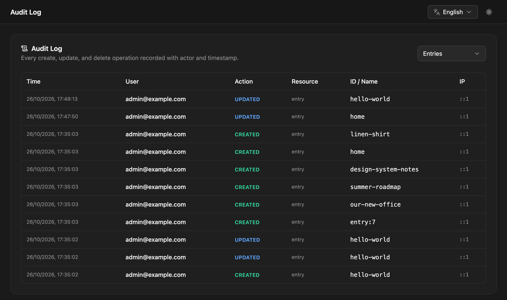

The audit log records changes made in NodePress: who did it, what they did, to which item, from which IP address and when. Use it to answer "who unpublished this page?" or "when was this API key created?".

Only admins can view it.

## Viewing the log

Open **Audit Log**. The newest events come first, 50 per page. Filter by resource with the dropdown at the top.



| Column | Meaning |
|---|---|
| **Time** | When it happened |
| **User** | The email of the person who did it |
| **Action** | What they did, such as `created`, `updated`, `role_changed` |
| **Resource** | What kind of item: entry, content type, user… |
| **ID / Name** | Which item: an entry's slug, a content type's name, a user's ID |

## What's recorded

| Resource | Actions recorded |
|---|---|
| Entries | created (including translations), updated (including status changes and version restores), deleted (moved to trash), restored from trash |
| Content types | created, updated, deleted; installed from a [starter template](/content/templates/) |
| Components, choice lists | created, updated, deleted |
| Users | invited (created), invitation resent, role changed, deleted, password changed; signed in through SSO |
| Roles | created, updated, deleted |
| API keys | created, revoked |
| Media | uploaded, deleted |
| Releases | created, updated, deleted, published |
| Redirects | created, updated, deleted |
| Plugins | installed, updated, deleted, enabled, disabled, settings changed, server restarted |
| Settings | content languages, email and storage settings changed |
| Imports | WordPress import started |

Each event can carry extra details, such as an entry's content type, a role change's new role, or which plugin settings changed. Secret values, like plugin passwords, are never written to the log.

Not everything is recorded. Bulk entry actions, password sign-ins, and changes to forms and webhooks don't create events.

:::note
Writing to the audit log never blocks the change itself. If an event can't be saved, the change still goes through and the error is logged on the server.
:::

## Retention

Events older than 90 days are deleted every Sunday at 03:00 (server time). Change the period with `AUDIT_LOG_RETENTION_DAYS`:

```bash title="backend/.env"
AUDIT_LOG_RETENTION_DAYS=365
```

To keep events longer than that, export them on a schedule through the API, or back up the database ([Backups](/deployment/backups/)).

## API

```bash
curl -H "Authorization: Bearer $TOKEN" \
  "https://cms.example.com/api/audit-log?resource=entry&page=1&limit=50"
```

| Parameter | Default | Meaning |
|---|---|---|
| `resource` | all | One of `entry`, `content_type`, `user`, `api_key`, `media`, `plugin`, `settings`, `release`, `role`, `redirect`, `component`, `choice_list`, `import` |
| `page` | `1` | Page number |
| `limit` | `50` | Events per page, at most 100 |

```json
{
  "data": [
    {
      "id": 812,
      "userId": 1,
      "userEmail": "admin@example.com",
      "action": "role_changed",
      "resource": "user",
      "resourceId": "4",
      "metadata": { "newRole": "editor" },
      "ip": "203.0.113.7",
      "createdAt": "2026-10-26T09:00:00.000Z"
    }
  ],
  "meta": { "total": 1, "page": 1, "limit": 50, "totalPages": 1 }
}
```

The IP address is only right when NodePress knows the client's address behind your proxy; set `TRUST_PROXY` for your deployment ([Self-hosting](/deployment/self-hosting/)).
