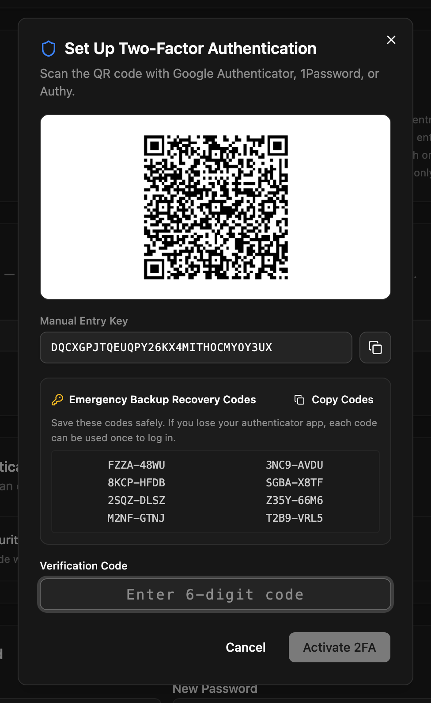

Users sign in to the admin with an email and password, or through [single sign-on](/access-control/sso/). A successful sign-in gives them a short-lived **access token** for API calls and a long-lived **refresh cookie** that gets a new access token when the old one runs out.

This page covers the flows and the endpoints behind them, for anyone building their own login or calling the API as a user. For machine access, use [API keys](/access-control/api-keys/) instead.

## First run: creating the admin

A fresh install has no users. The admin redirects to `/setup`, where you enter a site name, an admin email and a password. That creates the first account, with the `admin` role.

| Endpoint | What it does |
|---|---|
| `GET /api/auth/setup-status` | `{ "required": true }` while no user exists |
| `POST /api/auth/register` | `{ email, password }` creates the first admin and returns an access token |

`POST /api/auth/register` works only while there are no users. After that it returns `409`, and new users are [invited](/access-control/users-and-roles/#adding-a-user) by an admin.

## Signing in

```bash
curl -X POST https://cms.example.com/api/auth/login \
  -H "Content-Type: application/json" \
  -c cookies.txt \
  -d '{ "email": "admin@example.com", "password": "…" }'
```

```json
{
  "access_token": "eyJhbGciOi…",
  "user": { "id": 1, "email": "admin@example.com", "role": "admin" }
}
```

- Emails are matched case-insensitively.
- Wrong email and wrong password give the same `401` "Invalid credentials".
- For a user with a [custom role](/access-control/users-and-roles/#custom-roles), `role` is the role it's based on and `customRole` is its name.
- In production, login allows 10 attempts per minute per IP address.

If the user has two-factor authentication turned on, the response is different; see [Two-factor authentication](#two-factor-authentication).

## Access tokens

Send the access token on every API call:

```bash
curl -H "Authorization: Bearer eyJhbGciOi…" https://cms.example.com/api/auth/me
```

`GET /api/auth/me` returns the signed-in user. The token is a JWT signed with `JWT_SECRET`, and it's valid for `JWT_EXPIRES_IN` (default `7d`).

The user's role is looked up on every request, so a role change takes effect on their next call, and a deleted user's tokens stop working.

:::caution
A token can't be revoked before it expires. Signing out or resetting a password ends the refresh session, but an access token that was already issued keeps working until `JWT_EXPIRES_IN` runs out. Keep the lifetime short if that matters to you, and change `JWT_SECRET` to invalidate every token at once.
:::

## Refresh cookie

Sign-in also sets an HttpOnly cookie, `np_refresh`, valid for 30 days. It's only sent to `/api/auth/*`, and it's `Secure` in production.

| Endpoint | What it does |
|---|---|
| `POST /api/auth/refresh` | Exchanges the cookie for a new access token. The refresh token is **rotated**: the old one stops working and a new cookie is set. |
| `POST /api/auth/logout` | Deletes the refresh token and clears the cookie |

The admin calls `/api/auth/refresh` by itself when an API call returns `401`, so people stay signed in for up to 30 days of inactivity. After that, or after signing out, they sign in again.

## Password reset

1. On the login page, the user clicks **Forgot password?** and enters their email.
2. NodePress emails a reset link to `/reset-password?token=…`, valid for 15 minutes.
3. The user sets a new password (at least 8 characters).

| Endpoint | Body | What it does |
|---|---|---|
| `POST /api/auth/forgot-password` | `{ email }` | Sends the reset email. Always answers with the same message, so it doesn't reveal which emails exist. |
| `POST /api/auth/reset-password` | `{ token, password }` | Sets the new password, or `400` for an invalid, used or expired token |

A reset signs the user out everywhere: all their refresh tokens are deleted. Requesting a new link makes earlier ones stop working. Both endpoints allow 5 requests per minute per IP in production.

:::note[Without email]
Outside production, `forgot-password` also returns the link as `devResetUrl`, and the admin shows it on screen, so you can reset a password locally without SMTP. In production the link is only emailed. If you lose access to a production install without email, run `npm run reset-password` in the project folder on the server.
:::

Signed-in users change their own password with `PUT /api/users/me/password` (`{ currentPassword, newPassword }`).

## Two-factor authentication

Two-factor authentication (2FA) adds a 6-digit code from an authenticator app (Google Authenticator, 1Password, Authy…) to the password.

### Turning it on

In the admin, the **Two-Factor Authentication (2FA)** card is on the **Users** page:

1. Click **Enable 2FA**.
2. Scan the QR code with your authenticator app, or type the **Manual Entry Key**.
3. Save the 8 **Emergency Backup Recovery Codes**. Each one works once, if you lose the app.
4. Enter a code from the app and click **Activate 2FA**.



To turn it off, click **Disable 2FA** and enter a code from the app or a recovery code.

:::note
The **Users** page is admin-only, so in the admin only admins can manage their own 2FA. Other roles can turn it on through the API below.
:::

### Signing in with 2FA

For a user with 2FA, `POST /api/auth/login` doesn't return a session. It returns a temporary token, valid for 5 minutes:

```json
{ "requires2fa": true, "tempToken": "eyJhbGciOi…" }
```

Send it with a code from the app, or a recovery code (`XXXX-XXXX`):

```bash
curl -X POST https://cms.example.com/api/auth/2fa/verify-login \
  -H "Content-Type: application/json" -c cookies.txt \
  -d '{ "tempToken": "eyJhbGciOi…", "code": "123456" }'
```

The response is the same as a normal login, and sets the refresh cookie. When a recovery code was used, it also has `"recoveryUsed": true` and `remainingRecoveryCodes`. A used recovery code can't be used again.

### 2FA endpoints

All but `verify-login` need the user's access token.

| Method | Path | Body | What it does |
|---|---|---|---|
| `GET` | `/api/auth/2fa/status` | | `{ "enabled": true }` or `false` |
| `GET` | `/api/auth/2fa/setup` | | A new `secret`, `otpauthUrl` (for the QR code), `recoveryCodes` and `hashedRecoveryCodes`. Nothing is saved yet. |
| `POST` | `/api/auth/2fa/enable` | `{ secret, code, recoveryCodes }` | Turns 2FA on once `code` matches `secret`. Send the `hashedRecoveryCodes` from setup as `recoveryCodes`. |
| `POST` | `/api/auth/2fa/disable` | `{ code }` | Turns 2FA off, with an app code or a recovery code |
| `POST` | `/api/auth/2fa/verify-login` | `{ tempToken, code }` | Completes a 2FA sign-in |

Codes are standard TOTP (SHA-1, 6 digits, 30-second steps); a code from the step before or after is accepted too, to allow for clock drift.

People who sign in through [SSO](/access-control/sso/) aren't asked for a NodePress 2FA code. Enforce two-factor at your identity provider instead.

## Summary of endpoints

| Method | Path | Auth |
|---|---|---|
| `GET` | `/api/auth/setup-status` | none |
| `POST` | `/api/auth/register` | none (first user only) |
| `POST` | `/api/auth/login` | none |
| `POST` | `/api/auth/refresh` | refresh cookie |
| `POST` | `/api/auth/logout` | refresh cookie |
| `GET` | `/api/auth/me` | access token |
| `POST` | `/api/auth/forgot-password` | none |
| `POST` | `/api/auth/reset-password` | reset token in the body |
| `GET`, `POST` | `/api/auth/2fa/…` | see above |
| `PUT` | `/api/users/me/password` | access token |
