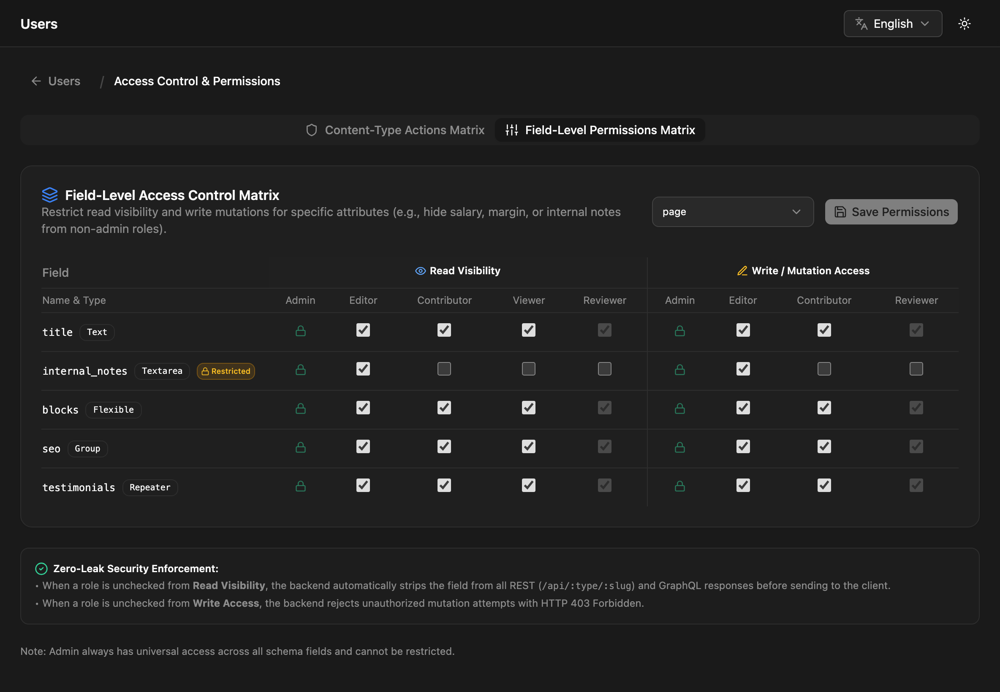

Field access rules hide a single field from some roles, or stop them from changing it, while the rest of the entry stays available. Typical uses: an internal note only editors see, a salary only admins see, a price contributors can read but not change.

A rule is a list of role names on the field:

| Option | Meaning |
|---|---|
| `readRoles` | Only these roles get the field in responses. Everyone else, including the public API, doesn't see it. |
| `writeRoles` | Only these roles may change the field. Anyone else who sends a different value gets `403`. |

No rule (the option missing or an empty list) means no restriction. Admins always pass both rules.

```json title="A field only admins and editors can see, and only admins can change"
{
  "name": "internal_notes",
  "type": "textarea",
  "readRoles": ["admin", "editor"],
  "writeRoles": ["admin"]
}
```

## Setting rules in the admin

Admins set them under **Users → Manage permissions**, on the **Field-Level Permissions Matrix** tab:

1. Pick a content type.
2. For each field, check which roles get **Read Visibility** and **Write / Mutation Access**.
3. Click **Save Permissions**.



All roles checked means no rule. Viewer-based roles have no write column, because they can't change entries at all. Saving updates the content type's schema, so the rules also show up in schema exports.

You can also put `readRoles` and `writeRoles` in the schema directly when you create or update a content type ([Fields](/content-modeling/fields/#options-every-field-has)).

## Custom roles

A rule matches a user if it lists their custom role **or** the role it's based on. A field with `"readRoles": ["admin", "editor"]` is visible to a custom role based on `editor`. To keep it from that custom role, list the roles that should see it without `editor`.

## Who counts as what

| Request | Checked as |
|---|---|
| Admin entry screens and `/api/entries` | the signed-in user's role |
| Public REST `/api/:type` reads, the typed GraphQL content queries, OpenAPI | **public**: no role, even with an API key or a login token |
| Public REST writes (`POST`/`PUT /api/:type`) | **public**: no role, even with a login token |
| Linked entries through `?populate=` | the same as the request, against the **linked** type's rules |

So on the public APIs:

- A field with any `readRoles` is never returned. It's left out of REST responses and of the OpenAPI document; in GraphQL a restricted relation field resolves to `null` (or an empty list).
- A field with any `writeRoles` can't be set through `POST`/`PUT /api/:type`. Change it in the admin or through `/api/entries` instead.

## Writes

`writeRoles` is checked against what you send:

- Fields you don't send are never a problem.
- On an update, sending a restricted field with its **current** value is allowed, so a form that posts back the whole entry still works.
- Sending a changed value is refused with `403`:

```json
{
  "statusCode": 403,
  "error": "Forbidden",
  "message": "You do not have permission to modify field \"price\". Allowed roles: admin, editor"
}
```

## Limits

- Rules apply to **top-level fields**. Rules set on a sub-field inside a group, repeater or flexible field aren't checked; restrict the container field instead.
- Hiding a field from responses doesn't make it unusable in queries. Don't rely on a hidden field's value staying secret if it can be filtered or sorted on through the public API.
- [Conditional fields](/content-modeling/conditional-fields/) only change the form. They don't restrict access.
