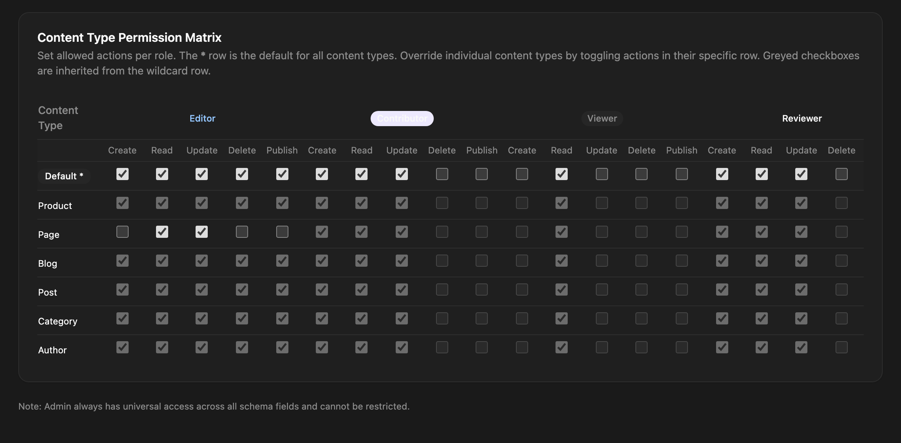

Content permissions decide what a role may do with the entries of each content type: create, read, update, delete and publish. Use them to give an editor publishing rights on the blog only, or to keep contributors out of a content type entirely.

Permissions sit on top of [roles](/access-control/users-and-roles/): the role opens or closes whole features, and permissions narrow them per content type. They can only take away what a role can reach. Giving a contributor `delete` doesn't let them delete, because the delete action is closed to contributors.

Only admins can change permissions. Admins themselves always have every permission.

## The permissions page

Open **Users** and click **Manage permissions**, or go to **Users → Roles** and click **Edit permissions**. The **Content-Type Actions Matrix** tab has one row per content type, plus a **Default \*** row at the top.



- The **Default \*** row is the role's permissions for every content type that has no row of its own.
- Toggling an action in a content type's row creates an **override** for that type. Greyed checkboxes are inherited from the default row.
- **Permission Summary** lists the role's overrides.
- **Reset to defaults** deletes every override and every changed default, for all roles.

The other tab, **Field-Level Permissions Matrix**, controls single fields. See [Field access](/access-control/field-access/).

## Actions

| Action | Checked when a user… |
|---|---|
| `create` | creates an entry, in the admin, through GraphQL or the public write API |
| `update` | saves changes to an entry, including bulk status changes |
| `delete` | moves an entry to the trash, one at a time or in bulk |
| `publish` | publishes an entry: on create, on save, by promoting it, in bulk, or in a release |
| `read` | currently not enforced; every signed-in user can read entries of every type in the admin |

:::caution[`read` doesn't hide content]
Unchecking **Read** doesn't stop a role from seeing a content type's entries in the admin. To keep data away from a role, restrict the fields with [field access rules](/access-control/field-access/).
:::

A release checks `publish` on the default row (`*`), because one release can touch many content types.

## Defaults

When a role has no permission rows at all, these apply:

| Role | Default actions |
|---|---|
| `admin` | all (always, not editable) |
| `editor` | `create`, `read`, `update`, `delete`, `publish` |
| `contributor` | `create`, `read`, `update` |
| `viewer` | `read` |

## How a check is resolved

For a user with role `R` acting on content type `T`:

1. If `R` is `admin`, allow.
2. If `R` has a row for `T`, use it.
3. Otherwise, if `R` has a default row (`*`), use it.
4. Otherwise, if `R` is a custom role, check its base role the same way (rows for `T`, then `*`, then the built-in defaults).
5. Otherwise, use the built-in defaults above.

A new custom role gets a default row with its base role's defaults when it's created, so in practice it stops at step 3. Step 4 applies only if you delete that row.

## Permissions API

All routes need an admin JWT. `:role` is a role name; `:contentType` is a content type name or `*`.

| Method | Path | Body | What it does |
|---|---|---|---|
| `GET` | `/api/permissions` | | All permission rows |
| `GET` | `/api/permissions/:role` | | One role's rows |
| `PUT` | `/api/permissions/:role/:contentType` | `{ "actions": [...] }` | Sets a row (creates or replaces it) |
| `DELETE` | `/api/permissions/:role/:contentType` | | Removes a row; the role falls back as described above |
| `PUT` | `/api/permissions/reset/all` | | Resets every role to its defaults |

```bash
# Editors may publish only blog posts: no publish by default…
curl -X PUT 'https://cms.example.com/api/permissions/editor/*' \
  -H "Authorization: Bearer $TOKEN" -H "Content-Type: application/json" \
  -d '{ "actions": ["create", "read", "update", "delete"] }'

# …but publish on blog
curl -X PUT https://cms.example.com/api/permissions/editor/blog \
  -H "Authorization: Bearer $TOKEN" -H "Content-Type: application/json" \
  -d '{ "actions": ["create", "read", "update", "delete", "publish"] }'
```

`actions` must be a subset of `create`, `read`, `update`, `delete` and `publish`. An empty list removes all access for that row. Setting rows for `admin`, or for a role that doesn't exist, returns `404`.

Reset restores one default row per role: the built-in defaults for `editor`, `contributor` and `viewer`, and each custom role's base role defaults.

## Where permissions apply

- **Admin** entry routes, including bulk actions and releases.
- **GraphQL** entry mutations.
- **The public write API** (`POST`, `PUT`, `DELETE /api/:type`) when the caller uses a login token. A create defaults to published, so it also needs `publish` unless the body sets `"status": "draft"`.

[API keys](/access-control/api-keys/) don't have a role. Their access is set on the key itself.
