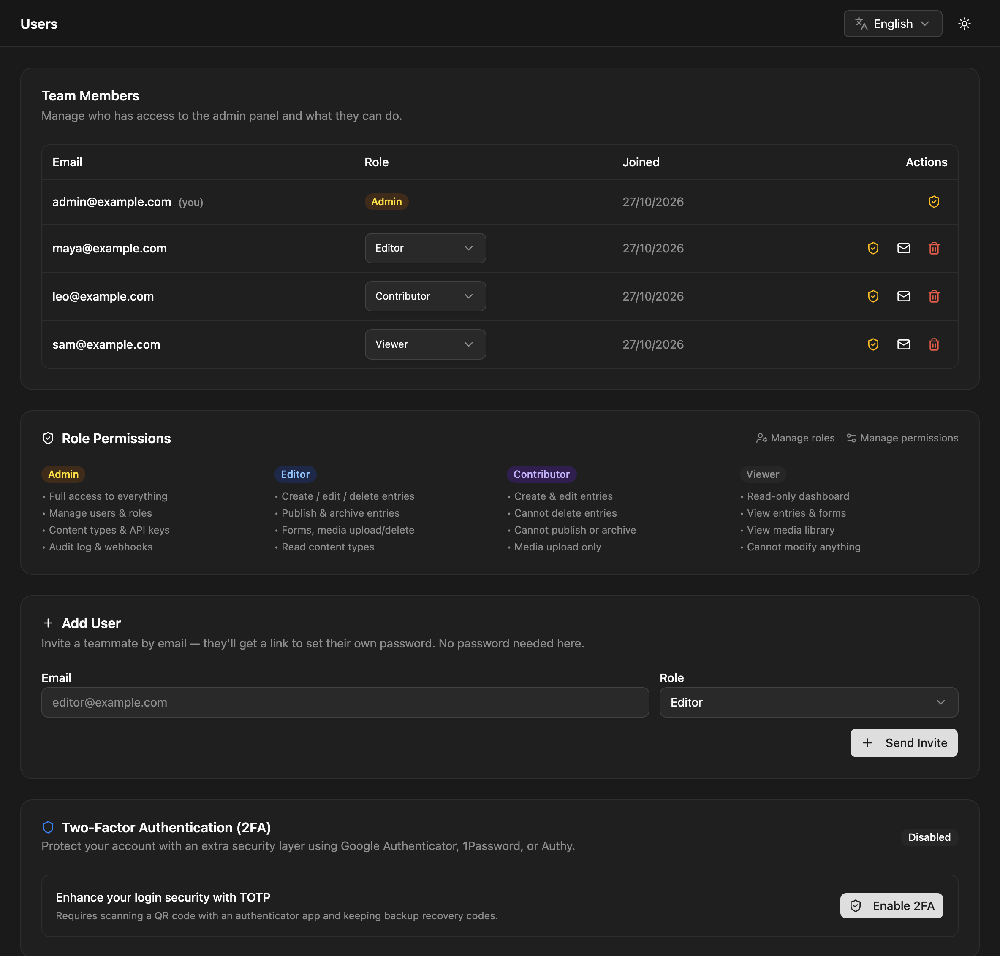
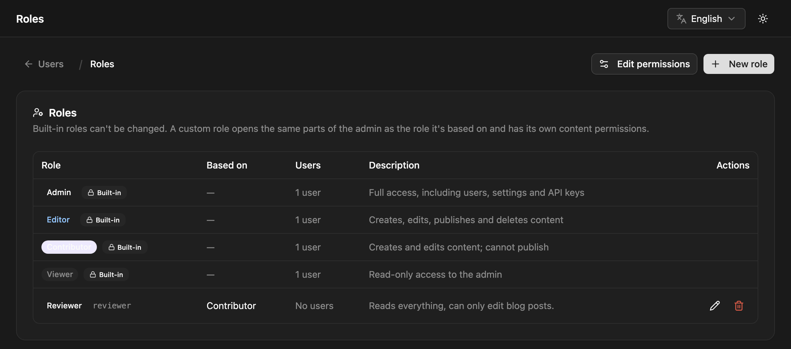

Everyone who signs in to the admin is a **user** with exactly one **role**. The role's [permissions](/access-control/permissions/) decide which parts of the admin they can open and what they can do there. NodePress has four built-in roles, and you can add custom roles based on them.

Admins manage users, and can let another role do it with **Users → Edit** on the permissions page. Only admins manage roles.

## Adding a user

Onboarding is invite-only. You never set a password for someone else.

1. Open **Users** and fill in **Add User**: an email address and a role.
2. Click **Send Invite**.
3. The user gets a "Set your password" email with a link to `/reset-password`. They choose their own password there and can then sign in.



The invite link is valid for 7 days. Sending a new invite (the **Send invitation email** button on a user's row) makes any earlier link stop working.

:::note[No email server yet?]
When SMTP isn't configured, NodePress can't send the invite. The admin copies the invite link to your clipboard instead, so you can send it yourself. Outside production (`NODE_ENV` not `production`), the link is always returned this way, even when email works. Configure email under **Settings → Email & storage** or with `SMTP_*` variables; see [Email](/deployment/email/).
:::

The same thing through the API (admin JWT):

```bash
curl -X POST https://cms.example.com/api/users \
  -H "Authorization: Bearer $TOKEN" \
  -H "Content-Type: application/json" \
  -d '{ "email": "sam@example.com", "role": "editor" }'
```

```json
{
  "id": 4,
  "email": "sam@example.com",
  "role": "editor",
  "createdAt": "2026-10-26T09:00:00.000Z",
  "updatedAt": "2026-10-26T09:00:00.000Z",
  "invited": true,
  "inviteUrl": "https://cms.example.com/reset-password?token=…"
}
```

`role` defaults to `editor`. It can be a built-in role or the name of an existing custom role; an unknown role is refused with `400`. An email that's already registered gets `409`. `inviteUrl` is only present when the link wasn't (or couldn't be) emailed, as described above.

## Changing and removing users

On the **Users** page you can change a user's role from the role dropdown on their row, or delete the user.

- The change applies on the user's next request. Their existing login stays valid.
- You can't delete your own account.
- You can't delete or demote the **last admin**. Promote someone else first.
- Deleting a user stops their login tokens from working right away.
- Someone who isn't an admin can't give the `admin` role, change, delete or re-invite an admin, or change their own role.

## Built-in roles

| Role | What it's for |
|---|---|
| `admin` | Full access, always. Users, roles, permissions, settings, API keys, webhooks, plugins and the audit log |
| `editor` | Creates, edits, publishes and deletes content; manages media, forms, releases and redirects |
| `contributor` | Creates and edits content, but can't publish or delete it; sees media and releases |
| `viewer` | Read-only access to content, media and releases |

That's what each role gets out of the box. Apart from `admin`, every role's access is a set of [permissions](/access-control/permissions/) you can change: give editors the jobs queue, take forms away from them, let contributors publish one content type.

A contributor's way to get content published is to submit it for review. In the editor that's moving the entry to `pending_review`; someone who can publish then publishes it. See [Entries](/content/entries/).

Some things are admin-only whatever the permissions say: managing roles and permissions, installing plugins and restarting the server, and permanently deleting entries from the trash. Admins also bypass [field access rules](/access-control/field-access/).

## Custom roles

A custom role is a named role, such as `reviewer` or `blog_editor`, with its own permissions. It is **based on** one of `editor`, `contributor` or `viewer` (never `admin`). The base role is its starting point: a new custom role has its base role's access to every module and content type until you change it on the permissions page.

To create one, open **Users → Roles** and click **New role**.

| Field | Meaning |
|---|---|
| **Label** | The name people see, such as "Blog editor" |
| **Name** | The stored name, in `snake_case` (`blog_editor`). Users and permissions refer to it, so it can't be changed later. |
| **Based on** | `editor`, `contributor` or `viewer` |
| **Description** | Optional, what the role is for |



Then assign the role to users like any other, and adjust its access under **Edit permissions**.

- **Changing the base role** switches every module you haven't changed for the role to the new base role's level. For content: if you never customized the role's default content permissions, they switch to the new base role's defaults; if you did, they're kept, and the admin tells you so.
- **Deleting a role** is refused while users still have it (`409`, with the number of users). Give them another role first. The role's permissions are deleted with it.
- If a custom role is deleted out from under a user (for example directly in the database), that user is treated as a `viewer`.
- Built-in roles can't be changed or deleted, and a custom role can't use a built-in name.

### Roles API

All routes need an admin JWT, except `GET /api/roles`, which roles with **Users → View** can call too.

| Method | Path | Body | What it does |
|---|---|---|---|
| `GET` | `/api/roles` | | Built-in roles (`builtIn: true`) then custom roles, each with `userCount` |
| `POST` | `/api/roles` | `{ name, label, baseRole, description? }` | Creates a custom role |
| `PUT` | `/api/roles/:name` | `{ label?, baseRole?, description? }` | Updates a custom role; the response has `warnings` when customized permissions were kept |
| `DELETE` | `/api/roles/:name` | | Deletes a custom role, or `409` while it's assigned |

### Users API

Admins can call every route; other roles need the level shown.

| Method | Path | Who | What it does |
|---|---|---|---|
| `GET` | `/api/users` | Users → View | Lists users (`id`, `email`, `role`, `createdAt`, `updatedAt`) |
| `POST` | `/api/users` | Users → Edit | Invites a user: `{ email, role? }` |
| `PUT` | `/api/users/:id/role` | Users → Edit | Changes a user's role: `{ role }` |
| `POST` | `/api/users/:id/invite` | Users → Edit | Sends a new invite link |
| `DELETE` | `/api/users/:id` | Users → Edit | Deletes a user |
| `PUT` | `/api/users/me/password` | any signed-in user | Changes your own password: `{ currentPassword, newPassword }` (at least 8 characters) |

## Single sign-on users

With [SSO](/access-control/sso/), users can also be created on their first sign-in, and their role can follow their groups at the identity provider.
