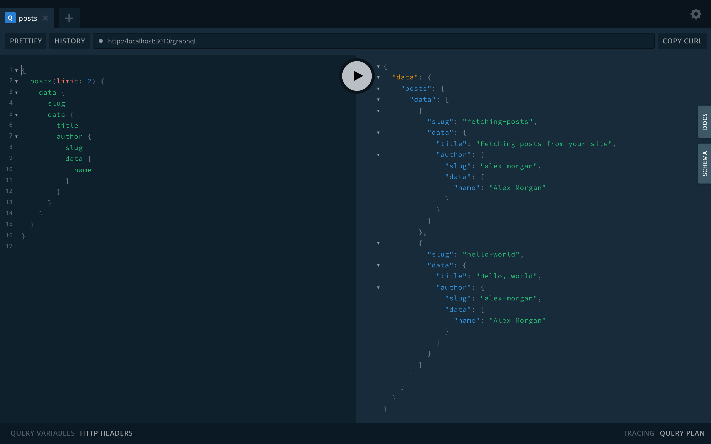

NodePress serves a GraphQL API next to REST. Every content type gets its own typed queries, built from its fields, so you select exactly the values you need and follow relations without `populate`. The schema updates itself when you change a content type.

## Endpoint

```text
POST http://localhost:3000/graphql
```

GraphQL is at `/graphql` on the backend, not under `/api`. The admin proxies it too (`http://localhost:5173/graphql` in development).

```bash
curl -X POST http://localhost:3000/graphql \
  -H "Content-Type: application/json" \
  -d '{ "query": "{ blogPosts(limit: 5) { data { slug data { title } } } }" }'
```

## Playground

Open `/graphql` in a browser to get the GraphQL Playground, with autocomplete and the full schema in the **Docs** panel. Admins find it in the admin under **Developer → GraphQL Playground**.



## Typed queries per content type

For each content type, NodePress adds a single-entry query and a list query, named from the content type:

| Content type | Entry type | Single query | List query |
|---|---|---|---|
| `blog_post` | `BlogPost` | `blogPost(slug: …)` | `blogPosts(…)` |
| `category` | `Category` | `category(slug: …)` | `categories(…)` |
| `faq` | `Faq` | `faq(slug: …)` | `faqs(…)` |

Names are converted to PascalCase for types and camelCase for queries, and the list query is the English plural. A content type only gets the queries its **API Endpoints** allow (`read` for the single query, `list` for the list query), so a private content type has none.

```graphql
{
  blogPost(slug: "hello-world") {
    id
    slug
    locale
    createdAt
    data {
      title
      views
      cover { url alt }
      author { slug data { name } }
    }
  }
}
```

Every entry type has `id` (the public UUID), `slug`, `locale`, `createdAt`, `updatedAt`, `seo` (JSON) and `data`. The single query returns `null` when there's no published entry with that slug.

### Arguments

Single query:

| Argument | Type | Meaning |
|---|---|---|
| `slug` | `String!` | the entry's slug |
| `locale` | `String` | language; default: the site's default language |
| `fallback` | `Boolean` | serve the default language when there's no translation |

List query:

| Argument | Type | Meaning |
|---|---|---|
| `where` | `JSON` | the same filters as REST `where` ([Querying](/apis/querying/#filtering-with-where)) |
| `search` | `String` | full-text search |
| `sort` | `String` | `"createdAt:desc"` (default), `"updatedAt:asc"`, `"slug:asc"`… |
| `page` | `Int` | page number |
| `limit` | `Int` | 1 to 100, default 20 |
| `cursor` | `String` | `meta.nextCursor` of the previous page, instead of `page` |
| `locale`, `fallback` | | as for the single query; without `locale` a list returns every language |

A list returns `data` and `meta`:

```graphql
query Posts($where: JSON) {
  blogPosts(where: $where, sort: "createdAt:desc", limit: 10) {
    data { slug data { title } }
    meta { total page limit totalPages nextCursor }
  }
}
```

```json title="variables"
{ "where": { "featured": { "eq": true }, "author": { "slug": { "eq": "jane" } } } }
```

`where` takes the same shape as the REST query string, written as JSON, including operators, `OR`/`AND` arrays and filters on related entries.

### Field types

Inside `data`, each field gets a GraphQL type from its field type:

| Field type | GraphQL type |
|---|---|
| text, textarea, rich text, color, date, datetime | `String` |
| number | `Float` |
| boolean | `Boolean` |
| select | `String`, or `[String!]` when multiple values are allowed |
| image | `NodePressImage` with `url` and `alt` |
| relation | the related entry type, or a list of them (see below) |
| json | `JSON` |
| group | an object type with the group's fields |
| repeater | a list of item types, each with the repeater's fields and `_id` |
| flexible | a list of a union of block types, one per layout (see below) |

Nested type names are built from the path: the `seo_box` group of `BlogPost` is `BlogPostSeoBox`, a `links` repeater's items are `BlogPostLinksItem`.

Fields restricted with read roles are in the schema but always return `null`, since the typed queries serve what the public may read. See [Field access](/access-control/field-access/).

### Relations

A top-level relation field resolves to the related entry type, so you select its fields directly:

```graphql
{
  blogPosts {
    data {
      slug
      data {
        author { slug data { name } }          # cardinality: one
        categories { slug data { label } }     # cardinality: many → a list
      }
    }
  }
}
```

[Reverse fields](/content-modeling/relations/#two-way-relations) resolve the same way and return the newest 100 linked entries. Related entries are always published ones, and each relation is loaded with one query for the whole response, however many entries ask for it.

A relation inside a group, repeater or flexible block stays an `ID` (or a list of IDs), as stored.

### Flexible fields

A flexible field is a list of a union type. Each layout is one member, with its fields and `_layout`. Use inline fragments to pick fields per layout:

```graphql
{
  page(slug: "home") {
    data {
      blocks {
        __typename
        ... on PageBlocksHero { heading image { url } }
        ... on PageBlocksQuote { text author }
      }
    }
  }
}
```

The member names are the entry type, the field and the layout in PascalCase: layout `hero` of field `blocks` on `page` is `PageBlocksHero`. Blocks whose layout no longer exists in the schema are left out.

## Drafts and authentication

The typed queries return **published** entries only, for every caller. There is no `stage` argument; use the REST API with credentials to read drafts ([Stages](/apis/rest/#stages-reading-unpublished-content)). Sending a token doesn't change what the typed queries return.

## Admin queries and mutations

The schema also has general queries and mutations that the admin side uses. They work with numeric entry IDs and take a signed-in user's token as `Authorization: Bearer <JWT>`; API keys aren't accepted.

| Operation | Who |
|---|---|
| `contentTypes`, `contentType(id)` | anyone: types open to the public API, without restricted fields; with a token, every type |
| `entries(contentTypeId, status, locale, search, page, limit)`, `entry(id, populate)` | anyone: published entries of types open to the public API; with a token, every status and type |
| `createEntry`, `updateEntry`, `restoreEntryVersion`, `bulkSetPendingReviewEntries` | admin, editor, contributor |
| `deleteEntry`, `restoreEntry`, `bulkDeleteEntries`, `bulkPublishEntries`, `bulkArchiveEntries` | admin, editor |
| `purgeEntry`, `createContentType`, `updateContentType`, `deleteContentType` | admin |
| `webhooks`, `webhook`, `webhookDeliveries`, `createWebhook`, `toggleWebhook`, `pingWebhook`, `deleteWebhook` | admin |

Entry mutations also check the user's [permissions](/access-control/permissions/) for the content type. `createEntry` and `updateEntry` take `data` as a JSON **string**:

```graphql
mutation {
  createEntry(contentTypeId: 3, slug: "from-graphql", status: "draft", data: "{\"title\":\"Hello\"}") {
    id
    publicId
    status
  }
}
```

For your site, prefer the typed queries: they have real types, resolve relations and follow your content types' API settings.

## Limits

- Queries nested deeper than 8 levels are rejected.
- GraphQL requests count toward the same per-IP rate limit as REST (120 per minute).

## Schema updates

The schema is rebuilt whenever a content type is created, changed or deleted, with no restart. With several backend instances, the others pick up the change within about 10 seconds.

A content type is left out of GraphQL, with a warning in the server log, if its name isn't a valid GraphQL name or its type or query name is already taken.
