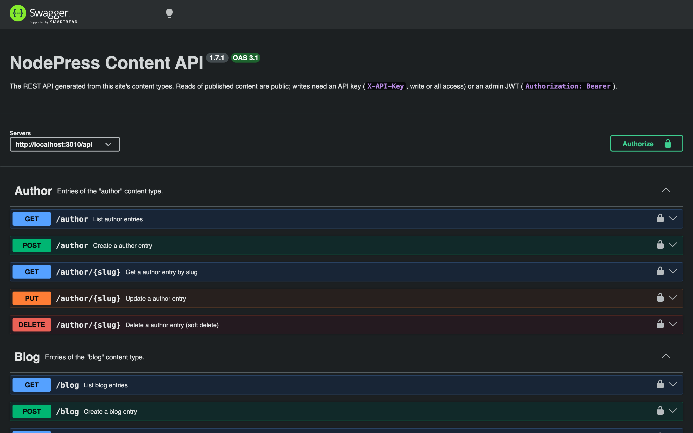

NodePress describes your content API as an OpenAPI 3.1 document, generated from your content types. Use it to browse and try the endpoints, generate a client in any language, or import the API into tools such as Postman or Insomnia.

## The document

```bash
curl http://localhost:3000/api/openapi.json
```

`GET /api/openapi.json` is public and needs no credentials. It's rebuilt whenever a content type changes, so it always matches the current schemas. On setups with several backend instances, each instance checks for changes on every request.

The server URL in the document is `APP_URL` + `/api`, so set `APP_URL` to your backend's public address in production.

## What it contains

For each content type, the document has:

- **Paths** for the operations its **API Endpoints** allow: `GET` and `POST` on `/{type}`, and `GET`, `PUT` and `DELETE` on `/{type}/{slug}`. Private content types are left out entirely.
- **Parameters** for each operation: paging, sorting, `where`, `search`, `fields`, `populate`, `locale`, `fallback`, `stage` and the `X-NodePress-Environment` header on reads.
- **Schemas** built from its fields, named after the content type (`blog_post` → `BlogPost`):

  | Schema | Describes |
  |---|---|
  | `BlogPost` | an entry as the API returns it |
  | `BlogPostData` | its `data` object |
  | `BlogPostList` | a list response with `data` and `meta` |
  | `BlogPostInput` | `data` for a create, with required fields marked |
  | `BlogPostUpdateInput` | `data` for an update, nothing required |

- **Responses** with their error codes (`400`, `401`, `403`, `404`, `409`, `422`).
- **Security schemes**: `ApiKey` (the `X-API-Key` header) and `bearerAuth` (a JWT). Reads list "no credentials" as an option; writes need one of the two.

The document describes what an anonymous caller sees. Fields with read roles are left out of the read schemas, and fields with write roles are left out of the inputs, because the public API refuses them. Operations are grouped by tag, using each content type's display name.

## Swagger UI

Two interactive references come with the backend:

| URL | Shows |
|---|---|
| `/api/docs/content` | your content API, from `/api/openapi.json` |
| `/api/docs` | the full NodePress API: authentication, content types, entries, media, forms, webhooks and the rest of the admin API |



Both have an **Authorize** button that the UI remembers between page loads. On `/api/docs/content` you can paste an API key or a JWT to try writes and unpublished stages; `/api/docs` takes a JWT, which you get from `POST /api/auth/login`. The content reference picks up content type changes on reload, without a restart.

## Generating a client

Any OpenAPI 3.1 generator can turn the document into a typed client:

```bash
npx openapi-typescript http://localhost:3000/api/openapi.json -o types/nodepress-api.ts
```

For JavaScript and TypeScript, the [JavaScript client](/apis/js-client/) together with `generate:types` is usually simpler.
