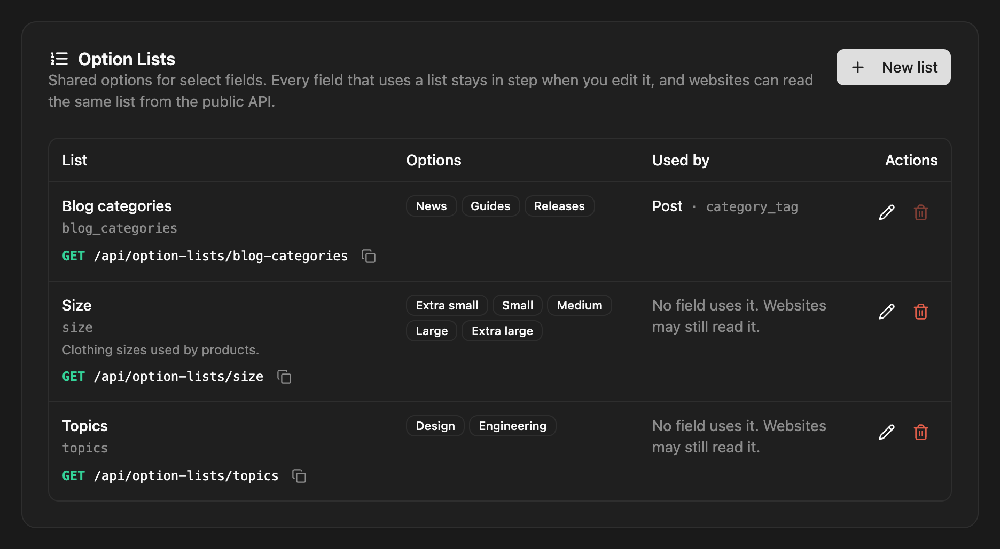
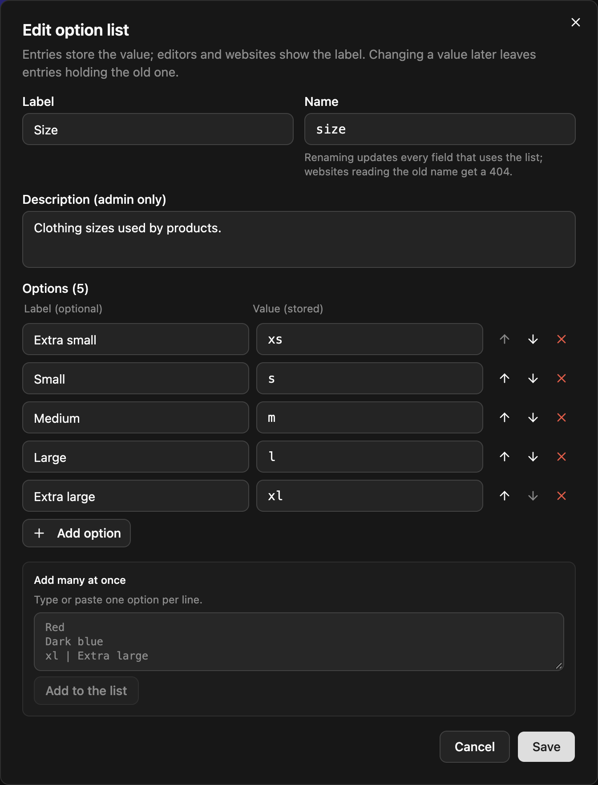

An **option list** is a set of options for `select` fields kept in one place, so every content type offers the same choices. Edit the list, and every field using it follows.

Manage them under **Content → Option Lists**. Editors can add and change lists; renaming or deleting a list is for admins, because websites read a list by its name. Each option has a **value**, which entries store, and an optional **label**, which editors and websites show. Change a label freely: entries keep the value. A changed value leaves entries holding the old one.

Tick **Select several** on a select field to let entries pick more than one option; they then store a list of values.

The page lists each list's options, the fields that use it, and its public address, such as `GET /api/option-lists/blog-categories`, with a button to copy it. A list no field uses is marked **No field uses it**: a website may still read it, so check before deleting.





## Using a list

A select field takes its choices either typed on the field (`options.choices`) or from a list (`options.choiceList`):

```jsonc
// Content → Option Lists → "Department"
{
  "name": "department",
  "label": "Department",
  "choices": [
    { "value": "eng", "label": "Engineering" },
    { "value": "sales", "label": "Sales" },
    { "value": "support" }
  ]
}

// A select field in any content type or component
{ "name": "department", "type": "select", "options": { "choiceList": "department" } }
```

When the field is saved, the server copies the list into it:

```json
{
  "name": "department",
  "type": "select",
  "options": {
    "choiceList": "department",
    "choices": ["eng", "sales", "support"],
    "choiceLabels": { "eng": "Engineering", "sales": "Sales" }
  }
}
```

`choiceLabels` holds only the labels that differ from their value. Entries store the value: `{ "department": "eng" }`.

This works wherever a select field can be: at the top level, inside repeaters, groups and flexible layouts, and in components. Put the field in a component used [inline](/content-modeling/components/#inline-components), and every content type including it gets the same top-level field.

## Editing a list

- Add options one at a time, or use **Add many at once**: one per line, as `Label` or `value | Label`. Drag to reorder.
- Saving updates every content type and component that uses the list.
- Removing a value doesn't change existing entries. The response reports how many entries still hold removed values (`removedValuesInUse`), and those entries fail validation on their next save until someone picks a new value.
- A list that a field uses can't be deleted (`409`). Switch those fields to their own choices first.
- Up to 1,000 choices per list. Values must be unique, non-empty and at most 200 characters.

## Reading lists from your site

Building a form or a filter? Read the same choices from the public endpoints. No key is needed, and responses are cached for 60 seconds:

```bash
GET /api/option-lists/department
GET /api/option-lists?names=department,country   # up to 50 at once
```

A name with underscores uses hyphens in the URL: `job_type` is `/api/option-lists/job-type`. The underscore form also works, and the response's `name` stays `job_type`.

```json
{
  "name": "department",
  "label": "Department",
  "choices": [{ "value": "eng", "label": "Engineering" }, { "value": "sales", "label": "Sales" }, { "value": "support" }]
}
```

The `?names=` form returns an array of lists.

## API

| Endpoint | Does | Who |
|---|---|---|
| `GET /api/option-lists/:name` | one list | public |
| `GET /api/option-lists?names=a,b` | several lists by name (max 50) | public |
| `GET /api/option-lists` | every list, with the content types, components and fields using it | admin |
| `POST /api/option-lists` | creates one: `{ name, label, description?, choices: [{ value, label? }] }` | admin |
| `PUT /api/option-lists/:id` | updates it and everything using it; returns `updatedContentTypes`, `updatedComponents`, `removedValues`, `removedValuesInUse`, `propagationErrors` | admin |
| `DELETE /api/option-lists/:id` | deletes it (`409` while a field uses it) | admin |

Schema exports and the `schema:pull` / `schema:push` CLI include option lists.
