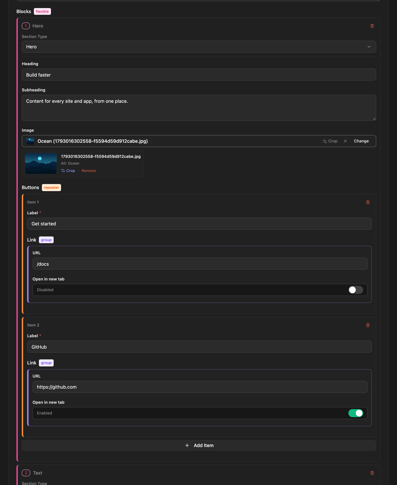

Three field types hold other fields:

| Type | Holds | Stored as |
|---|---|---|
| `group` | one fixed set of sub-fields | an object |
| `repeater` | any number of rows, all with the same sub-fields | an array of objects |
| `flexible` | any number of blocks, each using one of several layouts | an array of objects with `_layout` |

They can contain each other: a flexible block can hold a repeater of groups, a repeater row can hold another repeater, and so on, **up to three levels deep**. Every field type works at every level.

## Group

A group keeps related fields together under one key. It's a good fit for an address, social links or SEO metadata.

```json title="Schema"
{
  "name": "address",
  "type": "group",
  "options": {
    "subFields": [
      { "name": "street", "type": "text" },
      { "name": "city", "type": "text", "required": true },
      { "name": "country", "type": "select", "options": { "choices": ["IN", "US", "DE"] } }
    ]
  }
}
```

```json title="Entry data"
"address": { "street": "12 Park Road", "city": "Bengaluru", "country": "IN" }
```

## Repeater

A repeater is a list. Editors add, remove and drag rows; every row has the same sub-fields.

```json title="Schema"
{
  "name": "faq",
  "type": "repeater",
  "options": {
    "subFields": [
      { "name": "question", "type": "text", "required": true },
      { "name": "answer", "type": "richtext" }
    ],
    "minItems": 1,
    "maxItems": 20
  }
}
```

```json title="Entry data"
"faq": [
  { "_id": "k3j9x2", "question": "Is it free?", "answer": "<p>Yes, MIT licensed.</p>" },
  { "_id": "p8w1qa", "question": "Can I self-host?", "answer": "<p>That's the idea.</p>" }
]
```

`minItems` and `maxItems` are optional. Each row gets a stable `_id`, which works well as a React `key`.

## Flexible

A flexible field is a page builder: a list of blocks where each block picks a **layout**, and each layout has its own fields. Editors add blocks, choose their layout and reorder them. It works like ACF's flexible content.

```json title="Schema"
{
  "name": "sections",
  "type": "flexible",
  "options": {
    "layouts": [
      {
        "name": "hero",
        "label": "Hero banner",
        "fields": [
          { "name": "heading", "type": "text" },
          { "name": "image", "type": "image" }
        ]
      },
      {
        "name": "text_block",
        "label": "Text",
        "fields": [{ "name": "body", "type": "richtext" }]
      }
    ]
  }
}
```

```json title="Entry data"
"sections": [
  { "_id": "a1b2c3", "_layout": "hero", "heading": "Welcome", "image": { "url": "…", "alt": "" } },
  { "_id": "d4e5f6", "_layout": "text_block", "body": "<p>Some content.</p>" }
]
```

`_layout` says which layout a block uses. Your frontend switches on it:

```tsx
{page.data.sections.map((block) => {
  switch (block._layout) {
    case 'hero':       return <Hero key={block._id} {...block} />;
    case 'text_block': return <Text key={block._id} {...block} />;
  }
})}
```

Flexible fields also take `minItems` and `maxItems`.

When a block's layout is changed in the entry editor, the values of the old layout's fields are dropped on save — a block only ever holds its own layout's fields (plus `_id`, `_layout` and `_key`).

### Section keys

Public REST reads also return each top-level flexible field **by name**, as `<field>_by_key`, so site code can reach one section without counting positions:

```json title="GET /api/pages/home"
"sections": [
  { "_id": "a1b2c3", "_layout": "hero", "heading": "Welcome" },
  { "_id": "d4e5f6", "_layout": "quote", "_key": "intro_quote", "text": "…" },
  { "_id": "g7h8i9", "_layout": "quote", "_key": "closing_quote", "text": "…" }
],
"sections_by_key": {
  "hero": { "_id": "a1b2c3", "_layout": "hero", "heading": "Welcome" },
  "intro_quote": { "…": "…" },
  "closing_quote": { "…": "…" }
}
```

```ts
page.data.sections_by_key.hero.heading;
page.data.sections_by_key.closing_quote.text;
```

- A layout used **once** in the field is listed under its layout name — no key needed.
- A layout used **more than once** needs a **section key** on each of its sections. The entry editor marks the **Section key** box as required and won't save without it; the API refuses the entry with `422`.
- Keys use lowercase letters, digits and underscores, start with a letter, and are unique within the field. They're stored as `_key` and stay with their section when sections are reordered.
- A key wins over a layout name of the same spelling. `sections` itself keeps the editor's order, for rendering the page.
- `<field>_by_key` is only added by REST reads, and never when the content type has a real field of that name. GraphQL exposes `_key` on each section; OpenAPI and [generated types](/cli/generate-types/) describe both.

## Nesting

Containers can hold containers. This flexible layout holds a repeater of buttons, and each button has a group:

```json
{
  "name": "blocks",
  "type": "flexible",
  "options": {
    "layouts": [{
      "name": "hero",
      "fields": [
        { "name": "heading", "type": "text" },
        { "name": "buttons", "type": "repeater", "options": { "subFields": [
          { "name": "label", "type": "text" },
          { "name": "link", "type": "group", "options": { "subFields": [
            { "name": "url", "type": "text" },
            { "name": "new_tab", "type": "boolean" }
          ] } }
        ] } }
      ]
    }]
  }
}
```

```json title="Entry data"
"blocks": [{
  "_layout": "hero",
  "heading": "Build faster",
  "buttons": [{ "label": "Docs", "link": { "url": "/docs", "new_tab": false } }]
}]
```

### Limits

- **Three levels** of containers at most. Here `blocks` → `buttons` → `link` is three. A fourth level is refused with `400`.
- Some things only work on **top-level** fields: [component](/content-modeling/components/) references, reverse [relations](/content-modeling/relations/), [indexes](/content-modeling/fields/#indexed-fields) and `?populate=`. A relation inside a repeater stores IDs normally, but `?populate=` doesn't resolve it.
- [Conditions](/content-modeling/conditional-fields/) work at every level and compare fields within the same row, group or block.

## In the admin

The content type editor builds nested fields in place: open a container's settings to add its sub-fields or layouts. In the entry editor, repeater rows and flexible blocks can be added, collapsed, reordered by dragging and removed.


