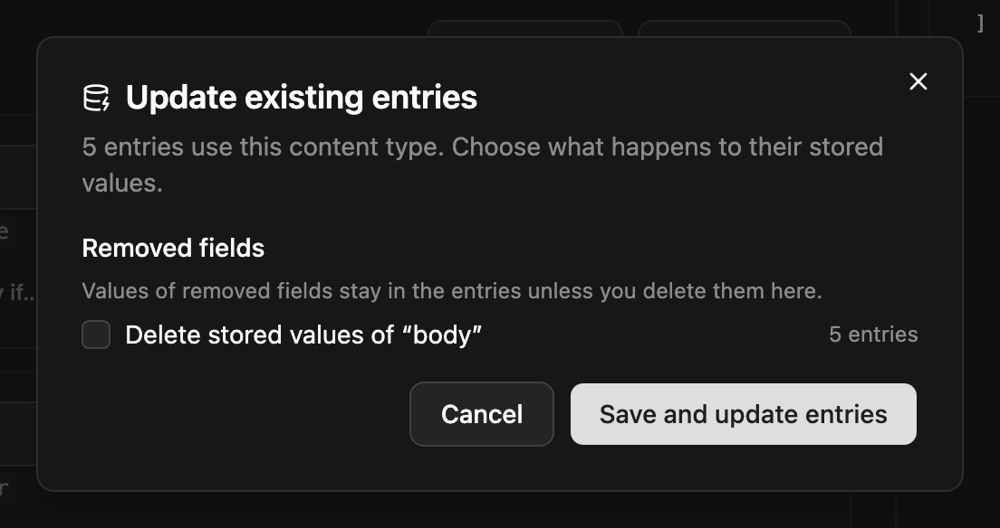

Entries keep their values as JSON, keyed by field name. So changing a schema doesn't move existing data by itself:

- **Rename** `headline` to `title`, and existing entries still have their value under `headline`.
- **Retype** `price` from text to number, and existing entries still hold strings.
- **Remove** a field, and its values stay in the database.

NodePress handles this for you. When you save a content type whose changed fields already hold data, the admin shows a **confirm dialog**: what changes, how many entries each change affects, and how many values a conversion would lose. You choose whether to rename, convert or delete the stored values along with the schema.



The schema change and the data change are applied in **one transaction**: both happen, or neither does.

## Through the API

Preview the impact first. It takes the same body as the update and changes nothing:

```bash
POST /api/content-types/:id/schema-impact
```

```json
{
  "entryCount": 120,
  "steps": [
    { "kind": "rename", "field": "title", "from": "headline", "entries": 118, "lost": 0 },
    { "kind": "convert", "field": "price", "fromType": "text", "toType": "number", "entries": 120, "lost": 3 }
  ],
  "removedNested": [],
  "warnings": []
}
```

Then apply the schema and the migrations together:

```json title="PUT /api/content-types/:id"
{
  "schema": [ … ],
  "fieldMigrations": {
    "renames": [
      { "from": "headline", "to": "title" },
      { "from": "seo.desc", "to": "seo.meta_description" }
    ],
    "convert": ["price"],
    "drop": ["legacy_notes"]
  }
}
```

| Step | What it does |
|---|---|
| `renames` | moves values from the old key to the new one |
| `convert` | converts values of retyped fields to the new type (by their new path) |
| `drop` | deletes the values of removed fields |

Steps run in this order: top-level renames, nested renames, conversions, then drops.

## Field paths

Nested fields are named by their path, using the containers' **new** names:

| Path | Means |
|---|---|
| `title` | a top-level field |
| `seo.meta_title` | a field of the `seo` group, or of every row of a `seo` repeater |
| `blocks.hero.heading` | the `heading` field of every `hero` block in the `blocks` flexible field |
| `blocks.hero.buttons.link.url` | deeper: the `url` of the `link` group, in every row of `buttons`, in every `hero` block |

Each group or repeater adds one segment to the path; each flexible field adds two (the field, then the layout). A rename must stay inside the same group, repeater or layout.

## Conversions

| From | To | How |
|---|---|---|
| anything | `json` | kept as-is |
| text, textarea, select | `richtext` | HTML-escaped and wrapped in `<p>` |
| `richtext` | text, textarea | HTML tags removed |
| text, number, boolean | text or `select` | converted to a string |
| text | `number` | numeric strings only |
| text, number | `boolean` | `true`/`yes`/`1`/`on` and `false`/`no`/`0`/`off` |
| multi-select | text or `select` | keeps the first value |
| text, number | multi-select | becomes a one-item list |

Values that can't be converted are removed. The preview counts them as `lost`, so you see the cost before you save.

## Good to know

- The editor tracks renames of sub-fields too and sends them for you. The preview's `removedNested` lists fields removed from inside a group, repeater or layout that still exists, and the dialog offers to drop their data.
- Renaming a flexible field's **layout** is not migrated: blocks saved with the old layout name keep it.
- Reverse relation fields in other content types follow a renamed relation field.
- Old entry versions keep the shape they were saved with.
- Every schema save is kept as a schema version.
