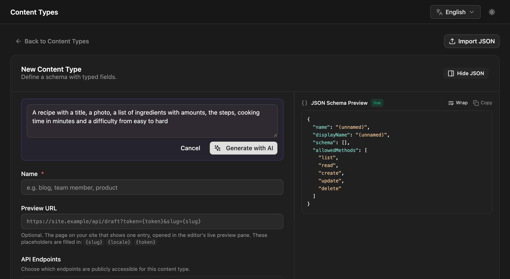

NodePress can use the Claude API to help in the admin. It does two things: suggest a content type from a description, and draft an entry's fields from a short brief. Both only fill in the form. Nothing is saved until a person reviews it and saves.

AI help is off until you add an API key, and the buttons don't appear without one.

## Turning it on

Get an API key from the [Claude Console](https://console.anthropic.com/) and set it on the server, then restart the backend:

```bash title="backend/.env"
ANTHROPIC_API_KEY=sk-ant-...
# Optional: the model to use (default claude-opus-5-5)
AI_MODEL=claude-opus-5-5
```

Requests go from your NodePress server to the Claude API and are billed to that key.

## Suggesting a content type

On the **New Content Type** page, click **Generate with AI** and describe what you want to manage:

> Events with a date, venue, ticket price and a list of speakers



The suggestion fills in the name and the fields, using the field types that fit best: a `datetime` for the date, a `number` for the price, a `repeater` for the speakers. Review the fields, change what you like, and save.

- Relation fields are only suggested to content types that already exist.
- Repeater, group and flexible fields come with their sub-fields or layouts.
- The suggestion is checked like any schema you'd write yourself. If it isn't valid, you get an error and can rephrase.

Only admins can create content types, so only admins see this button. It can be used 10 times a minute.

## Drafting an entry

In the entry editor, click **Draft with AI** and say what the entry should contain:

> A friendly 300-word post announcing our new opening hours

The draft fills the entry's top-level text, textarea, rich text, number, boolean, select, date, datetime and color fields. Other fields (images, relations, JSON, repeaters, groups, flexible fields) are left as they are. Values you've already entered are sent along, so the draft improves on them rather than ignoring them, and it replaces them in the form.

- Rich text comes back as simple HTML: paragraphs, headings, lists, links, bold, italic and quotes.
- Select fields get one of their choices.
- The draft is told to stick to the facts in your request and not to invent names, numbers or quotes. Check it anyway.
- Values are checked against the fields before they're returned.

Admins, editors and contributors can draft entries, 20 times a minute.

## What is sent to the Claude API

| Feature | Sent |
|---|---|
| Suggest a content type | Your description and the names of your existing content types |
| Draft an entry | Your request, the content type's name, the draftable fields' names, types, labels and help text, and the form's current values (up to 8,000 characters) |

Entries, media and settings aren't sent otherwise. Descriptions and requests can be up to 4,000 characters.

## Errors

| Message | Cause |
|---|---|
| AI is not configured | `ANTHROPIC_API_KEY` isn't set |
| The ANTHROPIC_API_KEY was rejected | The key is wrong or revoked |
| The AI service is busy | The Claude API rate-limited the request; try again in a minute |
| The suggested content type was not valid | Rephrase the description |
| The AI response was incomplete | Try a shorter request |

## API

| Method | Path | Who | What |
|---|---|---|---|
| `GET` | `/api/ai/status` | Any signed-in user | `{ "enabled": true, "model": "claude-opus-5-5" }` |
| `POST` | `/api/ai/content-model` | Admins | `{ "prompt": "…" }` returns `{ name, displayName, schema }` (not saved) |
| `POST` | `/api/ai/draft` | Contributors, editors, admins | `{ "contentTypeId": 3, "prompt": "…", "current": { … } }` returns `{ "data": { … } }` (not saved) |
