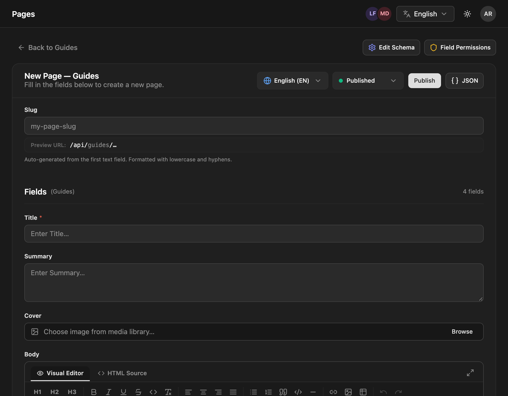
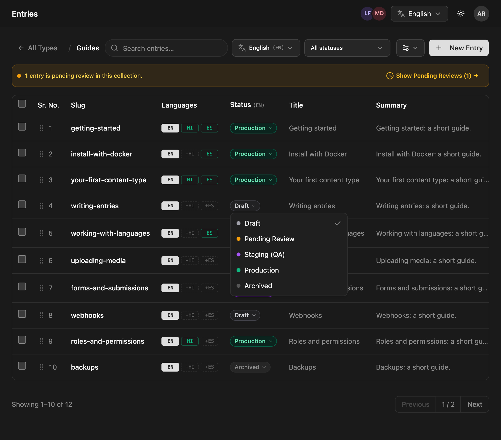
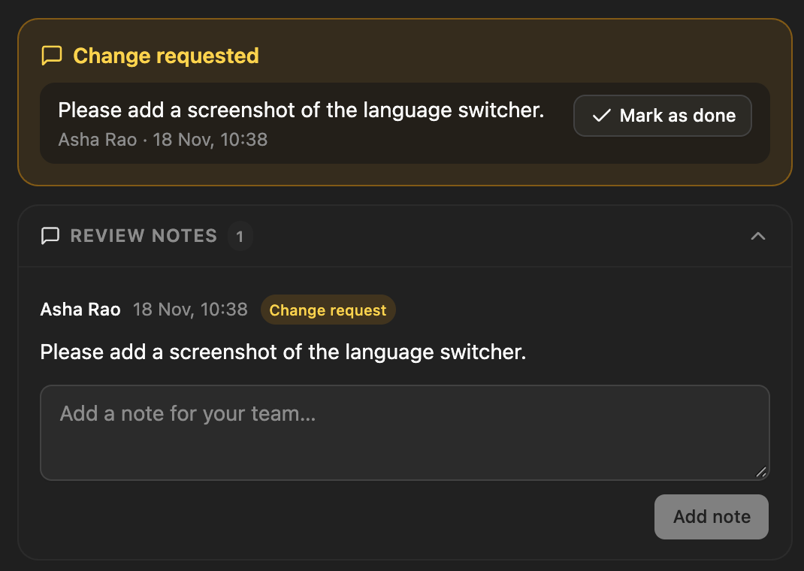
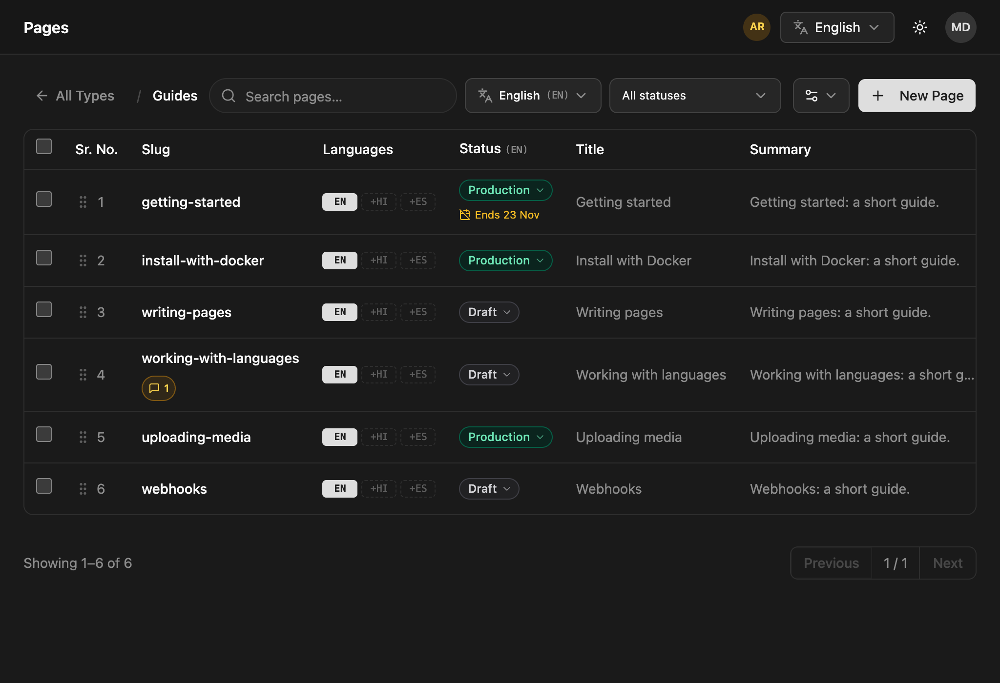
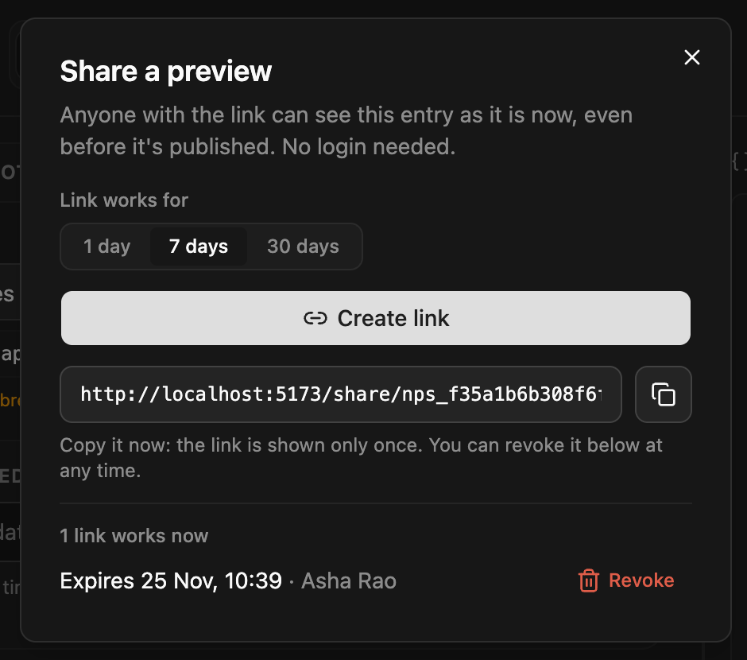
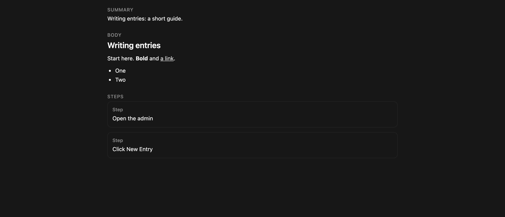
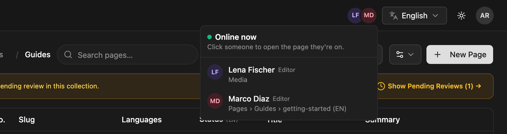
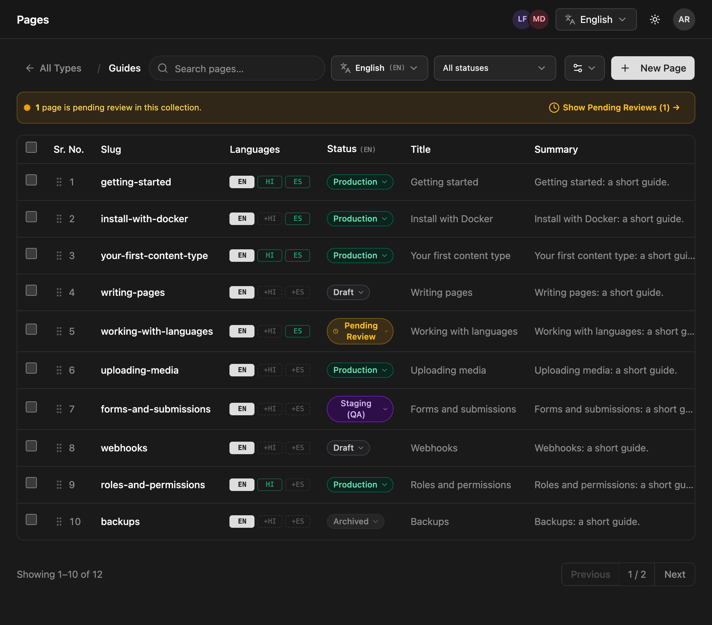

An entry is one piece of content of a content type: one post, one product, one page. You write entries in the admin under **Entries**, and your site reads them from the API. This page covers the editor and everything around it: slugs, statuses, review, scheduling, the trash and bulk actions.

## Creating an entry

Open **Entries**, pick a content type and click **New Entry**. The form shows one input per field of the content type's schema (see [Fields](/content-modeling/fields/)). Choose a status and a language at the top, then click **Create Entry** (or **Publish** when the status is Published).

Required fields must have a value before the entry saves. The server checks every value against the schema, so the same rules apply when entries are written through the API.

If the content type has a [Preview URL](/content-modeling/content-types/#preview-url), **Save draft & preview** saves the entry as a draft and opens it with the [live preview](/content/live-preview/) pane.

## Slugs

The slug is the entry's address: `/api/blog/hello-world`.

- On a new entry, the slug is generated from the first text or textarea field as you type. Once you edit the slug yourself, it stops following that field.
- A slug may contain lowercase letters, numbers, and single hyphens or underscores between them (`my-first-post`), up to 200 characters.
- It must be unique within its content type **and language**. The English and French translations of an entry share one slug.
- You can change the slug of an existing entry. The editor warns you, because links to the old address stop working.

When the slug of a published entry changes, NodePress adds a 301 redirect from the old path to the new one. See [Redirects](/content/redirects/#automatic-redirects-on-slug-change).

:::note
An entry in the trash still holds its slug. To reuse the slug, purge the trashed entry first.
:::

## Statuses

| Status | Meaning | Public API |
|---|---|---|
| **Draft** (`draft`) | Work in progress | Hidden |
| **Pending review** (`pending_review`) | Submitted for approval | Hidden |
| **Staging** (`staging`) | Ready for QA on a staging site | Only with `?stage=staging` and credentials |
| **Published** (`published`) | Live | Visible to everyone |
| **Archived** (`archived`) | Retired | Hidden |

Pick the status in the editor's status selector and save, or click an entry's status badge in the entries list and pick one there: it changes straight away. The list shows published entries as **Production**. Its menu only offers the statuses your role may set. Putting an entry on Production, or taking it off, asks you to confirm first, since visitors see that straight away; the other moves are instant. The message that follows has an **Undo** button. With several languages the list shows one language at a time, so the menu changes that language only. Picking any status other than Draft cancels a scheduled publish.

Unpublished stages can be read through the API with `?stage=draft`, `staging` or `all` and a login token or API key. See [REST API](/apis/rest/).

:::caution[Published entries change live]
A published entry has no separate draft copy. Saving it, including an autosave, updates what the API serves right away. To prepare changes without showing them, set the entry back to Draft, or use a [release](/content/releases/) to switch several entries at once.
:::

## Review workflow

Contributors can create and edit entries but not publish them (this is the default; admins can change it under **Users → Permissions**, see [Permissions](/access-control/permissions/)).

1. A contributor writes the entry and sets it to **Pending review**, or selects entries in the list and clicks **Submit for Review**.
2. The entries list shows how many entries are waiting, per content type. **Show Pending Reviews** filters to them.
3. An editor or admin opens the entry. A banner offers **Approve & Publish** or **Return to Draft**. **Return to Draft** asks for an optional note saying what to change. Picking **Draft** on a row waiting for review in the entries list asks for the same note.

### Review notes

Notes are how a reviewer and a writer talk about an entry without leaving the admin.

- **A note sent back with the entry is a change request.** The writer sees it at the top of the editor, in an amber box, and the entries list shows a speech-bubble badge with the number of open requests next to the slug.
- **Closing a request.** The writer clicks **Mark as done**, or sends the entry back to Pending review, which closes every open request on it. Publishing the entry closes them too.
- **The Review notes panel** under the editor's toolbar keeps every note with its author and time. Anyone who may edit or publish the entry can add a note; while the entry is waiting for review, **Send back with note** sends it back to Draft in one step. A closed request can be reopened. Notes can be deleted by their author or an admin.
- Viewers can read notes but not write them. Notes are not part of the entry's data, its versions or the public API.

A contributor who tries to save an entry as Published gets an error. New entries default to Published in the editor, so contributors should pick Draft or Pending review before creating one.

## Scheduled publishing

A draft can publish itself at a set time.

1. Set the status to **Draft**. The **Scheduled Publish** field appears.
2. Pick a date and time, and save.

NodePress checks every minute and publishes drafts whose time has passed. The entries list marks scheduled entries with **Scheduled** and the date. To cancel, clear the field and save. Publishing the entry by hand also clears the schedule.

Through the API, send `publishAt` (an ISO date-time) with `status: "draft"` to `POST /api/entries` or `PUT /api/entries/:id`, and `publishAt: null` to clear it.

To publish several entries together at one moment, use a [release](/content/releases/) instead.

## Scheduled unpublishing

An entry can take itself off the site at a set time, for an offer, an event or a notice that should end on a date.

1. Open the entry and pick a date and time in **Unpublish on**.
2. Save.

NodePress checks every minute. When the time passes, a published entry goes back to **Draft**, the date is cleared, and the `entry.updated` webhook fires with `scheduledUnpublish: true`. The entries list shows **Ends** and the date under the status of a published entry that has one. To cancel, clear the field and save. An entry that isn't published when the time comes is left alone.

Through the API, send `unpublishAt` (an ISO date-time) to `POST /api/entries` or `PUT /api/entries/:id`, and `unpublishAt: null` to clear it. It works together with `publishAt`: a draft can publish on Monday and unpublish on Friday.

## Sharing a preview

Send a link to someone without an admin login, such as a client, so they can see an entry before it's published.

1. In the editor, click **Share**.
2. Choose how long the link works: 1 day, 7 days or 30 days.
3. Click **Create link**. It's copied for you; copy it from the box again if you need to. The link is shown only once.

The person who opens the link sees the entry as it is at that moment: the fields the public may read (fields limited to some roles are left out), its status, and when the link stops working. If the content type has a [live preview](/content/live-preview/) URL, they see the page from your site, with a toggle to the plain content.

- The dialog lists the links that work now, with who made them and when they expire. **Revoke** stops a link at once.
- A link stops working when it expires, when it's revoked or when the entry is moved to the trash. Expired links are deleted from the database weekly.
- Only people who may edit the entry can make and revoke links. Making and revoking links is recorded in the audit log.
- The database keeps only a hash of each link, so a lost link can't be shown again: make a new one.
- Shared pages are not indexed by search engines and are never cached.

## Autosave

While you edit an existing entry, the editor saves your changes 3 seconds after you stop typing and shows **Saved**. Autosave sends the whole form, status included, so changing the status selector also takes effect after 3 seconds. New entries aren't autosaved until you create them.

Every save, autosaves included, keeps a [version](/content/versions/) of the entry as it was before.

## Editing together

The top bar shows the faces (initials) of the other people who have the admin open, beside your own. Click them to see who is where, for example **Entries › Pages › contact (EN)**, and click a person to open that page. When you're the only one signed in, nothing is shown.

When several people open the same entry, the editor shows who else is there and how many people are online. The first person holds a soft lock. Others see a banner saying who is editing, because saving at the same time can overwrite each other's changes.

- The lock is released when the holder leaves the entry, and expires a minute after their browser stops renewing it.
- Admins and editors can click **Take Over Lock**.
- The lock is a warning, not a block: anyone with permission can still save.

Presence uses the realtime connection described in [Realtime](/apis/realtime/).

## SEO fields

Every entry has an **SEO & Open Graph** section, separate from the content type's fields:

| Field | Key | Use |
|---|---|---|
| **SEO Title** | `seo.title` | Overrides the page title in search results |
| **Meta Description** | `seo.description` | The snippet under the title (120–160 characters recommended) |
| **OG Image URL** | `seo.image` | The image for social shares (1200×630 recommended) |
| **Exclude from search engines (noindex)** | `seo.noIndex` | Ask search engines not to index the page |

The API returns them in the entry's `seo` object (or `seo: null`). Your site renders the tags. See [SEO](/content/seo/).

## Other editor tools

- **JSON** shows the entry's data as JSON while you edit.
- **Reference** shows another language's translation next to the form. See [Languages](/content/languages/#translating-in-the-editor).
- **Live** opens the [live preview](/content/live-preview/) pane, when the content type has a Preview URL.
- **Release** adds the entry to a [release](/content/releases/) (editors and admins).
- **Draft with AI** fills the fields from a description, when [AI help](/content/ai/) is turned on.
- **Version History** lists earlier versions. See [Versions](/content/versions/).

## The entries list

The list shows the entries of one content type, 10 per page, numbered (**Sr. No.**), loading each page from the server, so a content type can hold any number of entries. The bar above it searches the slug (any part of it, so `serv` finds `services`) and whole words in field values, and filters by language and status; occasional tasks (export, import, schema, permissions) are in the tools menu beside **New Entry**. On a narrow screen the table keeps every column and scrolls sideways.

New entries start at the top. To change the order, drag a row by its handle next to the number. The order is saved at once, all languages of a page move together, and dragging on one page of the list leaves the other pages where they were. Your site can use the same order with `?sort=position:asc` (see [Querying](/apis/querying/#sorting)). Reordering doesn't change an entry's **Updated** date. Anyone else with the list open sees the new order straight away.

The language column shows which translations exist for each entry, and which are missing.

Row actions:

| Action | What it does |
|---|---|
| **Duplicate** | Creates a copy with the slug `<slug>-copy` (or `-copy-2` up to `-copy-10`) and opens it. |
| **Copy API URL** | Copies the entry's public API address. |
| Delete | Moves the entry to the trash. |

:::note
**Duplicate** copies the field data only. The copy is created as Published, in the `en` locale whatever the original's language, and without the SEO fields. Change its status and language before you edit it, if needed.
:::

## Bulk actions

Select entries with the checkboxes to act on all of them at once:

| Button | Status it sets | Who can use it |
|---|---|---|
| **Stage (QA)** | `staging` | Admins, editors |
| **Publish (Prod)** | `published` | Admins, editors |
| **Submit for Review** | `pending_review` | Admins, editors, contributors |
| **Archive** | `archived` | Admins, editors |
| **Add to release** | (added to a release) | Admins, editors |
| Delete | moves to the trash | Admins, editors |

A bulk action checks the user's permission for every content type involved, and changes nothing if any is not allowed.

## Trash

Deleting an entry moves it to the **Recycle Bin**. Trashed entries are hidden from the API and from the entries list, and they stay there until someone acts on them:

- **Restore** brings the entry back with its status and data (admins and editors).
- **Purge** deletes it and all its versions for good (admins only).

Through the API: `DELETE /api/entries/:id` moves an entry to the trash, `POST /api/entries/:id/restore` restores it, and `DELETE /api/entries/:id/purge` purges it. `GET /api/entries?deleted=true` lists the trash.

## Import and export

Editors and admins can export a content type's entries (everything except the trash) as JSON or CSV, and import entries from a JSON or CSV file. Both are in the tools menu next to **New Entry**, with **Edit schema** and **Permissions**:

- **Import…** runs a dry run first and shows each row as **Create** or **Update**, with any problems.
- Rows are matched to existing entries by slug and language. With **Update duplicate entries** on (the default), matching entries are updated; otherwise they're skipped.
- Imported rows without a status become drafts.

To move every content type and entry to another NodePress site at once, use a [site export](/content/site-export/).

## Admin API

The admin uses these endpoints. They all need a login token (`Authorization: Bearer <token>`).

| Method | Path | Who | What |
|---|---|---|---|
| `GET` | `/api/entries` | Any signed-in user | List entries. `?contentTypeId=`, `?status=`, `?locale=`, `?search=`, `?deleted=true`, `?page=`, `?limit=` (default 20, max 100) |
| `GET` | `/api/entries/:id` | Any signed-in user | One entry, with its `translations` |
| `POST` | `/api/entries` | Contributors, editors, admins | Create: `contentTypeId`, `slug`, `data`, optional `locale`, `status` (default `published`), `seo`, `publishAt`, `unpublishAt` |
| `PUT` | `/api/entries/:id` | Contributors, editors, admins | Update any of `slug`, `status`, `data`, `seo`, `publishAt`, `unpublishAt` |
| `DELETE` | `/api/entries/:id` | Editors, admins | Move to the trash |
| `POST` | `/api/entries/:id/restore` | Editors, admins | Restore from the trash |
| `DELETE` | `/api/entries/:id/purge` | Admins | Delete for good |
| `POST` | `/api/entries/:id/promote` | Contributors, editors, admins | Set `{ "status": "…" }`; contributors may only choose `draft` or `pending_review` |
| `POST` | `/api/entries/bulk-publish`, `bulk-stage`, `bulk-archive`, `bulk-delete` | Editors, admins | Body `{ "ids": [1, 2, 3] }` |
| `POST` | `/api/entries/bulk-pending-review` | Contributors, editors, admins | Body `{ "ids": [1, 2, 3] }` |
| `PUT` | `/api/entries/order` | Anyone who may update the type | Body `{ "contentTypeId": 4, "ids": [9, 3, 7] }`: those entries in their new order, taking the places they held |
| `GET` | `/api/entries/:id/notes` | Anyone who may read the type | The entry's review notes, oldest first |
| `POST` | `/api/entries/:id/notes` | Anyone who may update or publish the type | `{ "body": "…", "kind": "comment" \| "changes" }` (up to 2000 characters) |
| `PATCH` | `/api/entries/:id/notes/:noteId` | Anyone who may update or publish the type | `{ "resolved": true \| false }` |
| `DELETE` | `/api/entries/:id/notes/:noteId` | The note's author, admins | Delete a note |
| `GET` | `/api/entries/:id/share-links` | Anyone who may update the type | Links that work now (without their tokens) |
| `POST` | `/api/entries/:id/share-links` | Anyone who may update the type | `{ "days": 1 \| 7 \| 30 }`; the response has the `token` once |
| `DELETE` | `/api/entries/:id/share-links/:linkId` | Anyone who may update the type | Revoke a link |
| `GET` | `/api/share/:token` | Anyone, no login | The shared entry (public fields only) and its content type |
| `GET` | `/api/entries/export` | Editors, admins | `?contentTypeId=` and `?format=json` or `csv` |
| `POST` | `/api/entries/import` | Editors, admins | `?contentTypeId=`; body `{ entries, csvContent, dryRun, updateDuplicates }` |

Your site doesn't need these. It reads entries from the public `/api/:type` endpoints, see [REST API](/apis/rest/).
