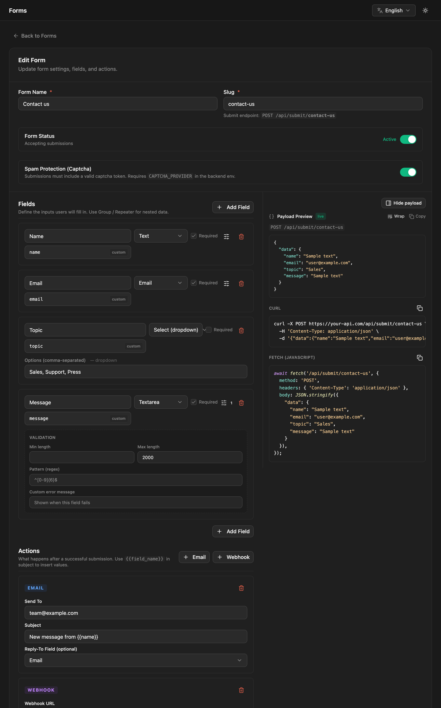

Forms collect input from your site's visitors: contact forms, sign-ups, applications. You define a form's fields in the admin, your site posts submissions to a public endpoint, and NodePress validates them, stores them and runs the form's actions (email, webhook).

Forms are separate from content types. A submission isn't an entry; it lives under the form's **Submissions**.

Forms and their submissions are managed by **admins and editors**. Other roles don't see **Forms** in the admin, and the forms API refuses them. Anyone can submit to a form.

## Building a form

Open **Forms** and click **New Form**.



1. Give the form a **Form Name**. The slug is generated from it; it's the form's address in the submit endpoint (`/api/submit/contact-us`).
2. Under **Fields**, click **Add Field** for each input. Each field has a label, a key (generated from the label, or set yourself), a type, and validation rules.
3. Under actions, add what should happen after each submission (see [Actions](#actions)).
4. Click **Create Form**.

**Form Status** turns submissions on and off. An inactive form refuses new submissions.

**Show payload** previews the JSON your site should send for the fields you've defined.

### Field types

| Type | Label | Submitted value |
|---|---|---|
| `text` | Text | a string |
| `textarea` | Textarea | a string |
| `number` | Number | a number (numeric strings are converted) |
| `email` | Email | a valid email address |
| `url` | URL | a valid URL |
| `phone` | Phone | 6–20 digits, spaces, `+ ( ) . -`, or your own pattern |
| `date` | Date | a date, stored as `YYYY-MM-DD` |
| `datetime` | Date & Time | a date and time, stored as ISO 8601 |
| `boolean` | Boolean (yes/no) | `true` or `false` |
| `select` | Select (dropdown) | one of the options |
| `radio` | Radio (single pick) | one of the options |
| `multiselect` | Multi-select | a list of options |
| `tags` | Tags (freeform) | a list of strings |
| `group` | Group (object) | an object with the group's sub-fields |
| `repeater` | Repeater (list) | a list of objects with the repeater's sub-fields |

Options for `select`, `radio` and `multiselect` are entered comma-separated.

### Validation rules

Each field can be **required** and, depending on its type, have:

| Rule | Applies to |
|---|---|
| Min / Max | numbers and dates |
| Whole number only | numbers |
| Min length / Max length | text fields |
| Pattern (regex) | text fields |
| Min items / Max items | multi-select, tags, repeater |
| Custom error message | all, replaces the default message |

Through the API, rules go in a field's `validation` object: `{ "required": true, "maxLength": 500, "message": "Keep it short" }`.

## Submitting from your site

`POST /api/submit/:slug` is public. Send the values under `data`, keyed by the fields' keys:

```bash
curl -X POST https://cms.example.com/api/submit/contact-us \
  -H "Content-Type: application/json" \
  -d '{
    "data": {
      "full_name": "Jane Doe",
      "email": "jane@example.com",
      "message": "Hello!"
    }
  }'
```

```json
{ "success": true, "submissionId": 42, "message": "Your submission has been received." }
```

Values are checked and converted against the form's fields. Keys that aren't fields of the form are dropped, and empty optional fields are stored as `null`.

| Status | When |
|---|---|
| `201` | Stored. The body is as above. |
| `400` | Validation failed, the form is inactive, or the captcha didn't pass |
| `404` | No form with this slug |
| `413` | The submission is larger than the limit |
| `429` | Too many submissions from this IP |

A validation failure lists every problem:

```json
{
  "message": "Validation failed",
  "errors": [
    { "path": "email", "rule": "email", "message": "\"Email\" must be a valid email address" },
    { "path": "message", "rule": "required", "message": "\"Message\" is required" }
  ]
}
```

Nested fields have paths like `address.city` or `guests[1].name`.

### Limits

| Limit | Default | Environment variable |
|---|---|---|
| Submission size | 100 KB | `FORM_MAX_PAYLOAD_BYTES` |
| Nesting depth | 3 | `FORM_MAX_DEPTH` |
| Items in one list | 100 | `FORM_MAX_ARRAY_ITEMS` |
| Fields in total | 200 | `FORM_MAX_FIELDS` |
| Submissions per IP | 20 per minute | |

## Spam protection

Every form has two protections built in:

- **Rate limiting**: 20 submissions per minute from one IP address.
- **Honeypot**: add a hidden field named `_honey` to your HTML form and send it with the data. People leave it empty; bots that fill in every field don't. A submission with a non-empty `_honey` gets a success response (with `submissionId: null`) but is not stored, and no actions run.

```html
<input type="text" name="_honey" tabindex="-1" autocomplete="off"
       style="position:absolute;left:-9999px" aria-hidden="true">
```

### Captcha

For stronger protection, turn on **Spam Protection (Captcha)** in the form builder. Each submission must then include a captcha token, which NodePress verifies with the provider:

1. Set the provider and its secret key on the server:

   ```bash title="backend/.env"
   CAPTCHA_PROVIDER=turnstile   # or hcaptcha, recaptcha
   CAPTCHA_SECRET_KEY=0x4AAAAAAA...
   ```

   The backend refuses to start when `CAPTCHA_PROVIDER` is set without `CAPTCHA_SECRET_KEY`.

2. Add the provider's widget to your form with its **site key**, and send the token it produces as `captchaToken`:

   ```json
   { "data": { "email": "jane@example.com" }, "captchaToken": "XXXX.DUMMY.TOKEN" }
   ```

Supported providers are Cloudflare Turnstile (`turnstile`), hCaptcha (`hcaptcha`) and Google reCAPTCHA v2 or v3 (`recaptcha`; a v3 score below 0.5 fails).

Without `CAPTCHA_PROVIDER` on the server, the captcha switch has no effect and submissions aren't checked. If the provider can't be reached, the submission is accepted.

## Actions

Actions run after a submission is stored. They run in the background, so a slow mail server or endpoint never delays the visitor's response. A failing action is retried, after 1 minute and then 10 minutes, and admins can see and retry it under **Developer → Jobs**.

### Email

Sends the submission to an address.

| Setting | Meaning |
|---|---|
| **Send To** | The recipient |
| **Subject** | The subject line. `{{field_key}}` inserts a submitted value: `New message from {{full_name}}` |
| **Reply-To Field (optional)** | A field whose value becomes the email's Reply-To, so you can answer the sender directly |

The email lists each field's label and value, with your brand's name, logo and color. Email needs SMTP to be set up; without it, email actions are skipped. See [Email](/deployment/email/).

### Webhook

Sends the submission to a URL as JSON, with a 10-second timeout:

```json
{ "data": { "full_name": "Jane Doe", "email": "jane@example.com", "message": "Hello!" } }
```

| Setting | Meaning |
|---|---|
| **Webhook URL** | Where to send it |
| **Method** | `POST` (default) or `PUT` |

A response other than 2xx counts as a failure and is retried. Through the API, a webhook action can also have `headers`, for example an authorization header for the receiving service.

Form webhooks are separate from the site-wide [webhooks](/apis/webhooks/), which report entry and media changes.

## Submissions

**Forms** lists each form with its submission count. **View submissions** opens the form's submissions, newest first, with search and **Export CSV**. Each submission stores the data, the submitter's IP address and the time.

Deleting a form deletes all its submissions.

## API

The form management endpoints need a login token. Your site only needs `POST /api/submit/:slug`.

| Method | Path | What |
|---|---|---|
| `POST` | `/api/submit/:slug` | Public: submit `{ "data": { … }, "captchaToken": "…" }` |
| `GET` | `/api/forms` | List forms with submission counts. `?page=`, `?limit=` (default 50) |
| `POST` | `/api/forms` | Create: `name`, `slug`, `fields`, optional `actions`, `isActive`, `captchaEnabled` |
| `GET` | `/api/forms/:id` | One form |
| `PUT` | `/api/forms/:id` | Update |
| `DELETE` | `/api/forms/:id` | Delete the form and its submissions |
| `GET` | `/api/forms/:id/submissions` | Submissions, newest first. `?page=`, `?limit=` (default 50, max 200) |
| `GET` | `/api/forms/submissions/recent` | The 6 newest submissions across all forms |

A form definition:

```json
{
  "name": "Contact Us",
  "slug": "contact-us",
  "isActive": true,
  "captchaEnabled": false,
  "fields": [
    { "name": "full_name", "type": "text", "label": "Full Name", "validation": { "required": true } },
    { "name": "email", "type": "email", "label": "Email", "validation": { "required": true } },
    { "name": "topic", "type": "select", "label": "Topic", "options": ["Sales", "Support"] },
    { "name": "message", "type": "textarea", "label": "Message", "validation": { "required": true, "maxLength": 2000 } }
  ],
  "actions": [
    { "type": "email", "to": "team@example.com", "subject": "New message from {{full_name}}", "replyToField": "email" },
    { "type": "webhook", "url": "https://hooks.example.com/contact", "method": "POST" }
  ]
}
```

Group and repeater fields list their sub-fields in `fields`.
