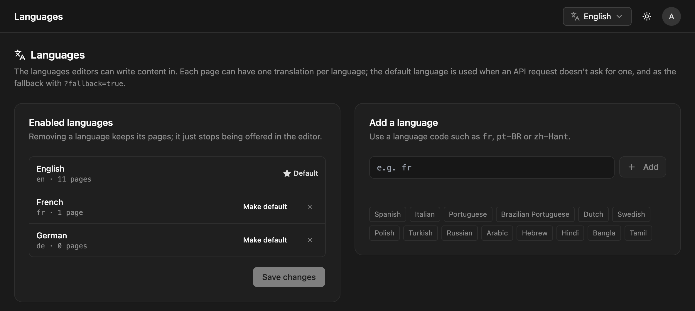

NodePress can hold the same content in several languages. Each entry has a `locale`, and translations of an entry share its slug: `hello-world` in English and `hello-world` in French are two entries of one content type, linked by that slug.

## Enabling languages

Admins set the languages under **Settings → Languages**.



- **Add a language** takes a language code such as `fr`, `pt-BR` or `zh-Hant` (up to 50 languages). Codes are stored in their standard casing, so `pt-br` becomes `pt-BR`.
- **Make default** sets the **default language**. It's used when an API request doesn't ask for a language, and as the fallback with `?fallback=true`.
- Removing a language keeps its entries. It only stops being offered in the editor. The page shows how many entries each language has, and lists languages that have entries but aren't enabled, so you can enable them again.

A new install has one language, `en`.

## Translating in the editor

In the page editor, the **Language** switcher sits under the toolbar and stays in view while you scroll: one tab per enabled language, each with a dot for its status (green published, purple staging, blue in review, amber draft). The **Fields** heading shows which language you're editing.

- Click a tab to open that language. What you typed is saved first, the same way autosave does, so nothing is lost.
- A dashed **+ Language** tab creates the entry in that language as a **draft**, with a copy of the current content to translate, and opens it. If the translation exists already, the editor opens it.
- **Reference** shows another translation next to the form while you write. **Copy Empty Fields from …** fills the fields you haven't filled yet from that language.

When you create a new entry, pick its language in the language selector. It starts on the default language.

## The pages list

With more than one language, the pages list shows **one language at a time**. Pick it with the language switcher above the list (**文A English ▾**); it opens in the default language, then in the last one you picked in that browser. Every row, its status and its actions belong to that language, so publishing or deleting from the list never touches another language.

A **Languages** column shows a chip per language, each in the same place on every row; hover a chip to see that language's status:

- **Filled chip**: the language you're viewing. **Green outline**: a translation that exists. Click it to open that translation.
- **Dashed `+XX` chip**: a missing translation. Click it to create it as a draft copy and open it.

`GET /api/entries` rows carry `translationEntries`: every language's `id`, `locale` and `status`. `GET /api/entries?group=true` returns one row per page instead (the default-language entry, or the oldest translation); `group` is ignored with `locale`.

All languages of a page share its slug, since that's what links them. Changing the slug in any language renames every language of the page together (published ones get a redirect from the old URL), and a slug another page uses in any of those languages is refused with `409`.

Each translation is a separate entry with its own status, versions and SEO fields. Publishing the English version doesn't publish the French one.

## Reading translations from the API

| Request | Returns |
|---|---|
| `GET /api/blog/hello-world` | The entry in the **default** language |
| `GET /api/blog/hello-world?locale=fr` | The French entry, or 404 if there is none |
| `GET /api/blog/hello-world?locale=fr&fallback=true` | The French entry, or the default-language entry when there's no French one |
| `GET /api/blog` | Entries in **all** languages |
| `GET /api/blog?locale=fr` | French entries only |
| `GET /api/blog?locale=fr&fallback=true` | French entries, plus default-language entries that have no published French translation |

Every entry in a response has its `locale`, so you can tell which language you got:

```json
{
  "id": "8c0f8e6e-5b1a-4a39-9d62-0f3c2b6a1d44",
  "slug": "hello-world",
  "locale": "en",
  "data": { "title": "Hello world" },
  "seo": null,
  "createdAt": "2026-10-26T09:00:00.000Z",
  "updatedAt": "2026-10-26T09:00:00.000Z"
}
```

Single-entry reads also send a `Content-Language` header with the locale that was served. With `?fallback=true` it differs from the `?locale=` you asked for when the fallback was used.

The [JS client](/apis/js-client/) can set `locale` and `fallback` once for every request.

## Languages in URLs on your site

NodePress doesn't render your site, so how languages appear in your URLs is up to you (`/fr/blog/hello-world`, `fr.example.com`, …). Two features need to know:

- The content type's [Preview URL](/content-modeling/content-types/#preview-url) can include `{locale}`.
- [Automatic redirects](/content/redirects/#automatic-redirects-on-slug-change) put `/{locale}` in front of the path for entries that aren't in the default language, unless the Preview URL gives the path.

## Languages API

| Method | Path | Who | What |
|---|---|---|---|
| `GET` | `/api/locales` | Public | `{ "defaultLocale": "en", "locales": ["en", "fr"] }`, default first |
| `PUT` | `/api/locales` | Admins | Set `{ "defaultLocale": "en", "locales": ["en", "fr", "de"] }`; the default must be one of the languages |
| `GET` | `/api/locales/usage` | Editors, admins | Number of entries per locale |
| `POST` | `/api/entries/:id/translate` | Contributors, editors, admins | `{ "targetLocale": "fr", "copyData": true }` creates a draft translation, or returns the existing one |

`GET /api/locales` is cached on the server for up to a minute. Saving the languages clears that cache.
