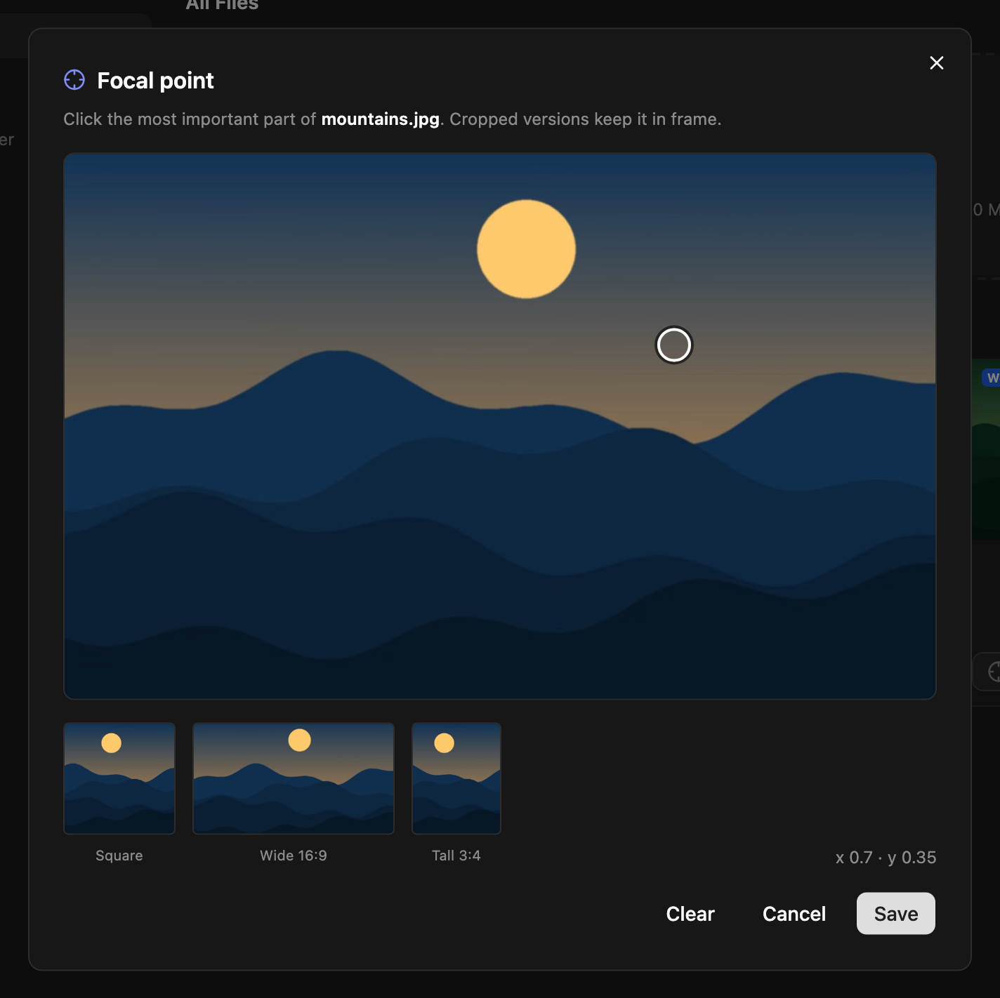

The media library holds the images and files your entries use. Uploaded images are optimized automatically, and the transform endpoint serves them at whatever size your site needs.

## Uploading

Open **Media** and drop files on the upload area, or click it to browse. Admins and editors can upload; everyone signed in can browse the library.

| | |
|---|---|
| Allowed types | JPEG, PNG, GIF, WebP, SVG, PDF, MP4 |
| Maximum size | 10 MB per file, or what [`MEDIA_MAX_MB`](/reference/environment-variables/) sets |

Behind nginx, `client_max_body_size` (50 MB in the shipped `nginx/proxy.conf`) must be at least `MEDIA_MAX_MB`, or larger uploads are refused before they reach NodePress. The same limit applies to files the [WordPress importer](/content/wordpress-import/) downloads.

NodePress checks each file's first bytes, so a file whose content doesn't match its type is refused. Uploaded files get a new name: the upload time and a random suffix, such as `1730000000000-9f86d081884c7d65.jpg`. The original name is kept in the library.

### What happens to images

JPEG, PNG and WebP images are processed when you upload them:

- rotated according to their EXIF orientation;
- scaled down to fit 2400 × 2400 pixels if they're larger (never scaled up);
- re-compressed in their own format;
- JPEG and PNG images also get a **WebP copy** next to the original.

The library has **Copy URL** and **Copy WebP URL** for each image. GIFs are stored as they are, with their dimensions recorded but no WebP copy. If the server is busy processing other uploads, an image is stored without optimization rather than failing.

### SVG

An SVG is a document that can contain script, so every uploaded SVG is rebuilt before it's stored:

- only drawing, text, gradient, mask, pattern and filter elements are kept — no `<script>`, `<foreignObject>`, animation or unknown elements; links (`<a>`) are replaced by their content;
- event handlers (`onclick`…) are removed, and references may only point inside the file (`href="#id"`, `url(#id)`); `<style>` loses `@import` and outside URLs;
- a file that declares entities, or isn't a valid SVG, is refused.

SVGs are served with a Content-Security-Policy that blocks scripts, so even opened directly they can't run anything. They're never converted to other formats: the width and height come from the file, and the transform endpoint returns the SVG itself.

## Folders

Folders are virtual: they organize the library but don't change file URLs.

- **New Folder** creates a folder inside the one you're in. Folders can be nested.
- Files uploaded while a folder is open go into it. **Move to Folder** moves a file later.
- **All Files** shows everything; **Unfiled** shows files in no folder.
- Deleting a folder deletes its sub-folders. Their files become unfiled, not deleted.

Admins and editors can manage folders.

## Images in entries

An `image` field opens the media picker. You can choose an image from the library or upload one, and add **Alt text**. The field stores the URL and the alt text: `{ "url": "https://…/1730000000000-9f86d081884c7d65.jpg", "alt": "A photo" }`. See [Fields](/content-modeling/fields/).

**Crop & Zoom** in the picker crops the image in the browser and uploads the result as a **new file**, so the original stays in the library unchanged.

## Focal point

The focal point marks the most important part of an image. When the transform endpoint crops the image to a different shape (`fit=cover` with a width and a height), the crop keeps the focal point in frame instead of cutting around the center.

In **Media**, open an image's menu and choose **Set focal point**, then click the subject. The dialog previews square, wide and tall crops. **Clear** goes back to center crops.



## Resizing images on the fly

`GET /api/media/:filename/transform` returns a resized or converted copy of an uploaded image. It's public, and each variant is generated once and then served from a cache.

```text
/api/media/1730000000000-9f86d081884c7d65.jpg/transform?w=800
/api/media/1730000000000-9f86d081884c7d65.jpg/transform?w=400&h=400&fit=cover&format=auto
```

| Parameter | Values | Default |
|---|---|---|
| `w`, `h` | Width and height in pixels. Rounded **up** to the next size: 16, 32, 48, 64, 96, 128, 192, 256, 320, 384, 480, 640, 750, 828, 960, 1080, 1200, 1440, 1600, 1920, 2048, 2560, 3200, 3840 | the original size |
| `q` | Quality from 30 to 100, rounded to steps of 10 | `80` |
| `format` | `webp`, `avif`, `jpeg` (or `jpg`), `png`, or `auto` | `webp` |
| `fit` | `cover`, `contain`, `fill`, `inside`, `outside` | `inside` |
| `fp` | The image's focal point as `x,y` (see below) | |

- Sizes are rounded to a fixed list so that each image has a limited number of variants.
- Images are never enlarged beyond their original size.
- `format=auto` serves AVIF or WebP when the browser's `Accept` header allows it, otherwise JPEG, and sends `Vary: Accept`.
- `/api/media/:filename/resize` is the same endpoint under another name.
- It works with local and S3 storage.

Responses are cached by browsers and CDNs for a year (`immutable`). The one exception is a focal-point crop (`fit=cover` with `w` and `h`): moving the focal point changes the output but not the URL, so those responses are cached for an hour, unless the URL carries `fp=` with the current focal point (`fp=0.3,0.6`, as `focalX,focalY` from the media record). Then the URL changes whenever the focal point does, and the response can be cached for a year.

The [JS client's](/apis/js-client/) `imageUrl()` builds these URLs for files on local storage. It returns other URLs, such as S3 ones, unchanged.

Two variants are generated at a time and up to 50 requests wait for a turn. Beyond that the endpoint answers `503`, and the request can be retried. Variants that haven't been requested for 30 days are deleted nightly, as are the least recently used ones when the cache grows past 2 GB. The environment variables `IMAGE_TRANSFORM_CONCURRENCY` (default `2`) and `IMAGE_VARIANT_CACHE_MB` (default `2048`) change these limits.

## Deleting files

Admins and editors can delete a file from its menu in **Media**. The WebP copy is deleted with it. Deleting doesn't check whether entries still use the file, so entries that point at it show a broken image.

## Where files are stored

By default, files are stored on the server's disk in `backend/uploads/` and served from `/uploads/<file>`. NodePress can store them in S3-compatible storage instead (AWS S3, Cloudflare R2, DigitalOcean Spaces, MinIO, Backblaze B2).

:::caution
On most hosting platforms and containers, the local disk is wiped when you redeploy, and every uploaded file is lost while the entries that use them remain. Use S3-compatible storage or a persistent volume in production. See [Storage](/deployment/storage/).
:::

## API

| Method | Path | Who | What |
|---|---|---|---|
| `POST` | `/api/media/upload` | Editors, admins | Upload one file as multipart form field `file`; returns the media record |
| `GET` | `/api/media` | Any signed-in user | List files, newest first. `?page=`, `?limit=` (default 50), `?folderId=` (`null` for unfiled) |
| `DELETE` | `/api/media/:filename` | Editors, admins | Delete a file and its WebP copy |
| `PUT` | `/api/media/:filename/focal-point` | Editors, admins | `{ "x": 0.3, "y": 0.6 }` (0 to 1 from the left and top), or nulls to clear |
| `PUT` | `/api/media/:filename/folder` | Editors, admins | `{ "folderId": 4 }`, or `null` for unfiled |
| `GET` | `/api/media/folders` | Any signed-in user | All folders as a flat list with `parentId` |
| `POST` | `/api/media/folders` | Editors, admins | `{ "name": "Products", "parentId": 4 }` |
| `PUT` | `/api/media/folders/:id` | Editors, admins | Rename: `{ "name": "…" }` |
| `DELETE` | `/api/media/folders/:id` | Editors, admins | Delete a folder and its sub-folders |
| `GET` | `/api/media/:filename/transform` | Public | Resized image, see above |

A media record:

```json
{
  "id": 7,
  "filename": "1730000000000-9f86d081884c7d65.jpg",
  "url": "http://localhost:3000/uploads/1730000000000-9f86d081884c7d65.jpg",
  "webpFilename": "1730000000000-9f86d081884c7d65.webp",
  "webpUrl": "http://localhost:3000/uploads/1730000000000-9f86d081884c7d65.webp",
  "originalName": "team-photo.jpg",
  "mimetype": "image/jpeg",
  "size": 182044,
  "width": 2400,
  "height": 1600,
  "focalX": null,
  "focalY": null,
  "uploadedBy": 1,
  "folderId": null,
  "createdAt": "2026-10-26T09:00:00.000Z"
}
```
