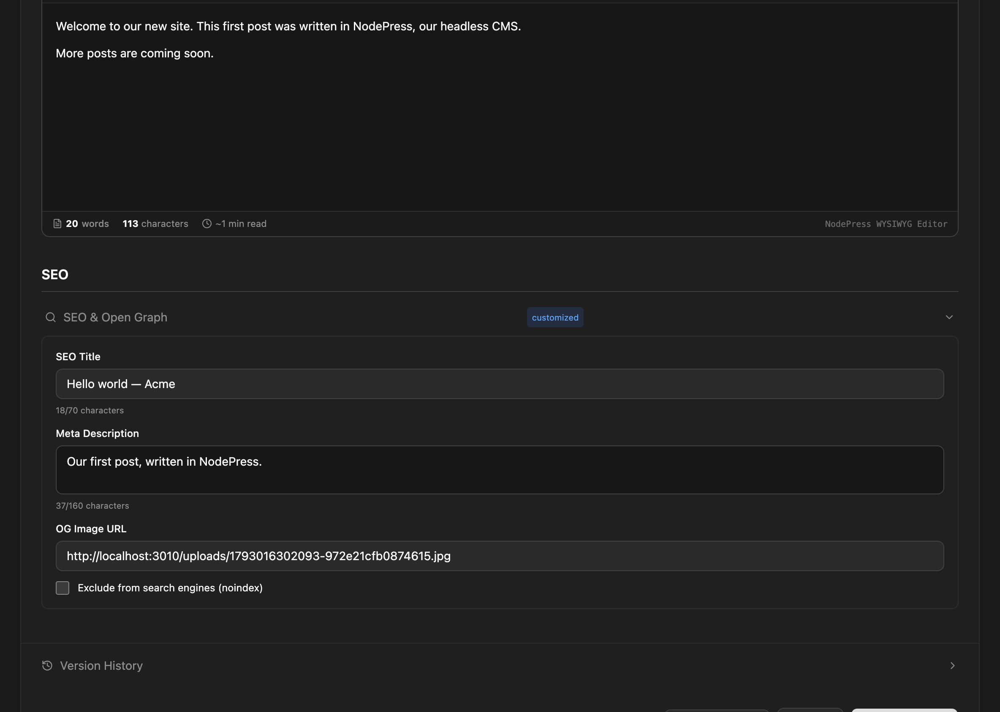

NodePress stores the SEO data your site needs and generates a sitemap and a robots.txt. Your site renders the actual `<title>` and `<meta>` tags, because NodePress doesn't render pages.

## SEO fields on an entry

Every entry has an **SEO & Open Graph** section in the editor, apart from the content type's own fields. It's marked **customized** when any of it is filled in.

| Field | Key | Use |
|---|---|---|
| **SEO Title** | `title` | The page title for search results, instead of the entry's own title |
| **Meta Description** | `description` | The snippet search engines show (120–160 characters recommended) |
| **OG Image URL** | `image` | The image for social media shares (1200×630 recommended) |
| **Exclude from search engines (noindex)** | `noIndex` | Ask search engines not to index the page; also keeps it out of the sitemap |



The API returns these in the entry's `seo` object, or `seo: null` when none are set:

```json
{
  "id": "8c0f8e6e-5b1a-4a39-9d62-0f3c2b6a1d44",
  "slug": "hello-world",
  "locale": "en",
  "data": { "title": "Hello world", "excerpt": "My first post." },
  "seo": {
    "title": "Hello world | Example Blog",
    "description": "How we built our first post with NodePress.",
    "image": "https://cdn.example.com/og/hello-world.jpg",
    "noIndex": false
  },
  "createdAt": "2026-10-26T09:00:00.000Z",
  "updatedAt": "2026-10-26T09:00:00.000Z"
}
```

Render them on your site, falling back to the entry's own fields:

```tsx
const title = entry.seo?.title ?? entry.data.title;
const description = entry.seo?.description ?? entry.data.excerpt;

<title>{title}</title>
<meta name="description" content={description} />
<meta property="og:title" content={title} />
{entry.seo?.image && <meta property="og:image" content={entry.seo.image} />}
{entry.seo?.noIndex && <meta name="robots" content="noindex" />}
```

Set them through the admin API with `seo` on `POST /api/entries` or `PUT /api/entries/:id`. Each translation of an entry has its own SEO fields.

## Sitemap

`GET /api/sitemap.xml` returns an XML sitemap of your published content:

- the home page, `<SITE_URL>/`;
- one list page per content type, such as `<SITE_URL>/blog-posts`;
- one URL per published entry, such as `<SITE_URL>/blog-posts/hello-world`, with its last update date.

The content type part of the path is its URL form: hyphens instead of underscores, as in the API. Left out are:

- entries marked **noindex**;
- entries and list pages of content types that don't offer the `read` or `list` endpoint (including [private content types](/content-modeling/content-types/#api-endpoints)).

```xml
<url>
  <loc>https://www.example.com/blog-posts/hello-world</loc>
  <lastmod>2026-10-26</lastmod>
  <changefreq>weekly</changefreq>
  <priority>0.6</priority>
</url>
```

The base address comes from the `SITE_URL` environment variable. `SITE_URL` is also the address NodePress uses for the admin in password reset and invitation links, so the sitemap is only correct as it is when your site and the admin share that address and your site uses `/{type}/{slug}` paths. The sitemap also lists every language version at the same URL. If your site's URLs differ, build the sitemap on your site from the API instead (`GET /api/:type` lists published entries).

## robots.txt

`GET /api/robots.txt` returns, with `ROBOTS_DISALLOW=/admin,/api/private` set:

```text
User-agent: *
Allow: /
Disallow: /admin
Disallow: /api/private

Sitemap: https://www.example.com/sitemap.xml
```

The `Disallow` lines come from the `ROBOTS_DISALLOW` environment variable, a comma-separated list of paths. Without it there are none. The `Sitemap` line uses `SITE_URL`.

Search engines look for these files at the root of your site, but NodePress serves them under `/api/`. Proxy or rewrite `/sitemap.xml` and `/robots.txt` on your site to the API's `/api/sitemap.xml` and `/api/robots.txt`, or serve your own.

## Related

- When a published entry's slug changes, NodePress adds a 301 redirect from the old address so links and rankings carry over. See [Redirects](/content/redirects/).
- Alt text for images is stored in each `image` field. See [Media](/content/media/#images-in-entries).
