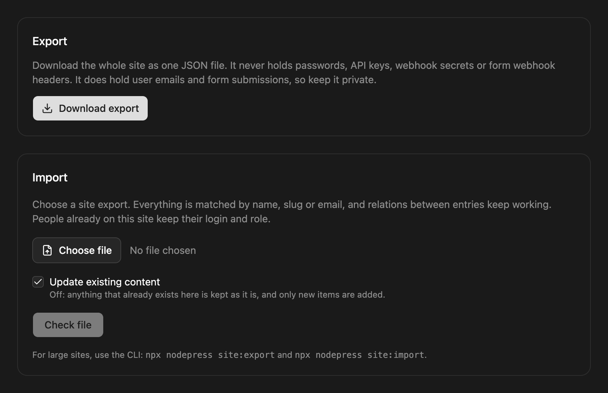
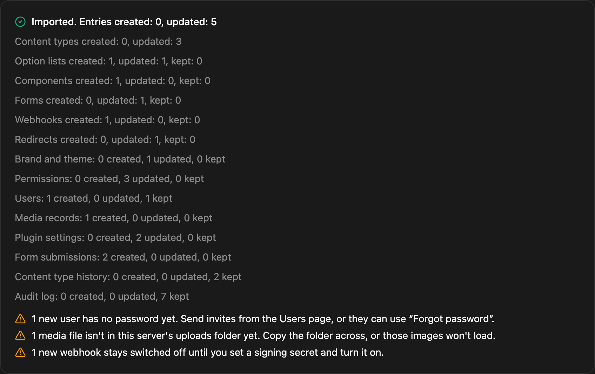

A site export is one JSON file with everything on the site except media files and credentials. Importing it into another NodePress install rebuilds the site there, or brings an existing one up to date. Typical uses: setting up a staging site from production, moving to a new server, or keeping a copy of the content outside the database.

Admins open **Settings → Export & import**. The [CLI](#from-the-command-line) does the same from a terminal or a script.

## What's in the file

| Included | Not included |
|---|---|
| Option lists, components and content types, as in a [schema export](/cli/schema/), and the order of their pages | **Media files:** copy the `uploads` folder by hand |
| Every entry, in every language and status, including the trash, with its version history | **Passwords** and two-factor secrets |
| The site's languages, brand and theme | **API keys** |
| [Forms](/content/forms/), their submissions and uploaded form files | **Webhook signing secrets** and form webhook headers |
| [Webhooks](/apis/webhooks/): name, URL, events | Passwords in email, storage and plugin settings |
| [Redirects](/content/redirects/): source, target, status code | Redirect hit counts |
| Users' emails and roles, custom roles, permissions and module access | Login sessions and password reset links |
| Media records and folders, so the Media library fills once the files are there | Queued jobs and webhook delivery history |
| Email and storage settings, plugin on/off state and settings, uploaded plugins | |
| Releases, content type history and the audit log | |

The file holds no credentials, but it does hold user emails, drafts, form submissions with visitors' personal details, and every field, including ones hidden from the public API. Keep it private.

### Moving media

Copy the `uploads` folder to the new server by hand. When you import, the preview tells you how many media files aren't there yet. Links to the old site's `/uploads/` are rewritten to the new site's address, in entries, their history, media records and the brand logo. Files on [R2, S3 or ImageKit](/deployment/storage/) have their own addresses and need no copying.

### After importing

- **Users** who are new to this site have no password yet. Send each one an invite from the Users page, or they can use **Forgot password**. Two-factor login has to be set up again. Anyone already on this site keeps their login and role.
- **API keys** have to be created again, so a website using one needs its new key.
- **New webhooks** stay off until you set a signing secret and turn them on. A webhook already on this site keeps its own secret and on/off state.
- **Form webhook actions** on new forms need their headers entered again. Existing forms keep the ones saved here.
- **Email, storage and plugin passwords** have to be entered again. Restart the server after a storage change.
- **Uploaded plugins** go through the normal review and signature checks, and new ones start switched off. Restart the server, then turn them on.

## Exporting

Click **Download export**. The file is named `nodepress-site-<date>.json`.



## Importing

1. Choose the file. Leave **Update existing content** on to overwrite what's already here, or turn it off to keep anything that already exists here as it is and add only what's missing.
2. Click **Check file**. Nothing is written yet: you see how many of each thing in the file will be created, updated, restored from the trash or kept, which languages will be added, and every problem in the file.
3. If there are no problems, click **Import**.


When the import finishes, the page shows what was created, updated and kept, and the same warnings:



How the import matches things:

- **Content types, components and option lists** are matched by name, exactly like a [schema push](/cli/schema/).
- **Entries** are matched by content type, slug and language. A match is updated, or restored if it's in the trash. Anything else is created.
- **Forms** are matched by slug. A match is updated in place, so it keeps its submissions. Anything else is created. Actions are imported as they are, so a staging site built from production emails the same recipients and calls the same webhooks until you change them.
- **Webhooks** are matched by name and URL, so a webhook with a new address is a new webhook. They start sending as soon as the import finishes, and the preview lists the addresses. On a test copy of a live site, change or switch them off right after importing.
- **Redirects** are matched by source path, with the same loop and chain checks as a CSV import. An updated redirect keeps its hit count.
- **Languages** in the file that the site doesn't have yet are added. The main language follows the file while **Update existing content** is on. No language is removed.
- **Users** are matched by email and never changed. New ones get no password.
- **Media records** are matched by filename, roles by name, and releases by name and creation time.
- **Form submissions and history** are only ever added, so importing a file twice doesn't duplicate them.
- **The trash** in the file never replaces or removes anything live on this site.
- **Nothing is deleted.** Whatever exists only on this site stays.
- **Overwritten entries can be restored.** The import saves a version of each entry whose content or status it changes, so you can bring it back from the entry's version history. Content types, forms, webhooks and redirects have no history, so take a [backup](/deployment/backups/) before importing over a site you care about.

The import is all or nothing for problems in the file: one invalid content type, entry, form, webhook or redirect, and nothing is written. If a write fails while the import runs, for example because a plugin rejects an entry, the other entries are still written and the failures are listed.

### Relations

Relation fields store the related entry's public id. A new entry keeps the id it had on the old site, so relations between imported entries work straight away. When an entry already exists here under another id (matched by slug and language), or its id is taken, every relation that points at it is rewritten to the id it has on this site. The preview shows how many entries that affects.

### Size

The admin and the API accept files up to 50 MB. Set `SITE_IMPORT_MAX_MB` on the backend for larger ones, and raise any limit in front of it, such as nginx's `client_max_body_size`. For very large sites, use the CLI.

## From the command line

`site:export` and `site:import` connect like the [schema commands](/cli/schema/#connecting): `NODEPRESS_URL` and `NODEPRESS_TOKEN`, an API key with `all` access to every content type or an admin JWT.

```bash
export NODEPRESS_URL=https://cms.example.com
export NODEPRESS_TOKEN=np_…

npx create-nodepress-app site:export --out production.json
NODEPRESS_URL=https://staging.example.com npx create-nodepress-app site:import production.json
```

| Option | Meaning |
|---|---|
| `--out <file>` | `site:export`: where to save. Default `nodepress-site.json` |
| `--dry-run` | `site:import`: show what would happen and stop |
| `--keep-existing` | `site:import`: keep content types and entries that already exist |
| `--yes` | `site:import`: don't ask before importing (needed outside a terminal) |

An API key moves the content only: users, roles, media records, settings, plugins, submissions and history need a signed-in admin, so that a key can't turn itself into an admin login. For a full copy, set `NODEPRESS_TOKEN` to an admin's access token.

`site:import` always shows the preview first and asks before writing. Exit codes: `0` done, `1` problems in the file or the import was cancelled, `2` an error such as a wrong URL or token.

## API

| Method | Path | Auth | Description |
|---|---|---|---|
| `GET` | `/api/site/export` | Admin, or an API key with `all` access to `*` | The site export as JSON |
| `POST` | `/api/site/import` | Admin, or an API key with `all` access to `*` | Import a site export. `?dryRun=true` only reports; `?overwrite=false` keeps existing content |

Both are recorded in the [audit log](/access-control/audit-log/).
