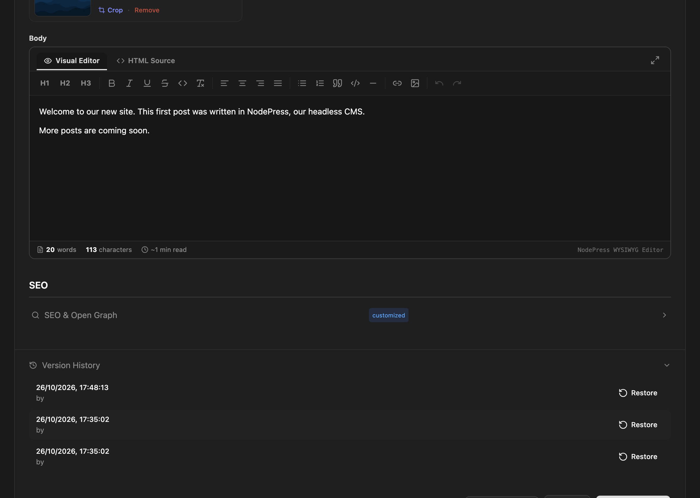

NodePress keeps a copy of an entry each time it changes, so you can see when it was edited and put an earlier version back. Content type schemas keep a similar history.

## Entry versions

Before an entry is updated, NodePress saves its current state as a version. That happens on every save from the editor (autosaves included), on **Promote to Staging (QA)**, **Publish to Production**, **Approve & Publish** and **Return to Draft**, when a version is restored, and when the WordPress import overwrites an entry.

Status changes made in bulk (the bulk action buttons, [releases](/content/releases/) and scheduled publishing) don't add a version, and neither do writes through the public API.

A version holds the entry's **slug**, **data** and **status**, the time, and who made the change. It does not hold the SEO fields, the language or the scheduled publish time.

Versions aren't pruned. They're deleted only when the entry is purged from the trash.

## Restoring a version

1. Open the entry and expand **Version History** at the bottom of the editor. The newest versions are listed first.
2. Click **Restore** next to the version you want.



Restoring replaces the entry's slug, data and status with the version's. The state you're replacing is saved as a new version first, so a restore can itself be undone.

Restoring a version can change the entry's status, for example put a published entry back to draft. It can also change the slug, and in that case no redirect is added from the current slug. Check both before you restore an entry that is live.

Admins and editors can restore versions. Anyone signed in can see the history.

## API

| Method | Path | Who | What |
|---|---|---|---|
| `GET` | `/api/entries/:id/versions` | Any signed-in user | The 50 most recent versions, newest first |
| `POST` | `/api/entries/:id/versions/:versionId/restore` | Editors, admins | Restore a version; returns the updated entry |

A version looks like this:

```json
{
  "id": 41,
  "entryId": 12,
  "slug": "hello-world",
  "data": { "title": "Hello world", "body": "<p>First draft.</p>" },
  "status": "draft",
  "createdBy": 1,
  "createdAt": "2026-10-26T09:00:00.000Z"
}
```

`createdBy` is the ID of the user whose save replaced this version, or `null` for changes not made by a user.

## Content type schema history

Each time a content type is saved with a schema, NodePress keeps the previous schema. An update that doesn't send a schema, for example one that only changes the preview URL, doesn't add one.

Admins can read the history through the API:

```bash
GET /api/content-types/:id/schema-history
```

It returns the 50 most recent schemas, newest first, each with `schema`, `changedBy` and `createdAt`. There's no restore button: to go back to an earlier schema, send it to `PUT /api/content-types/:id`. Remember that changing a schema doesn't change stored entry data by itself, see [Schema changes](/content-modeling/schema-changes/).
