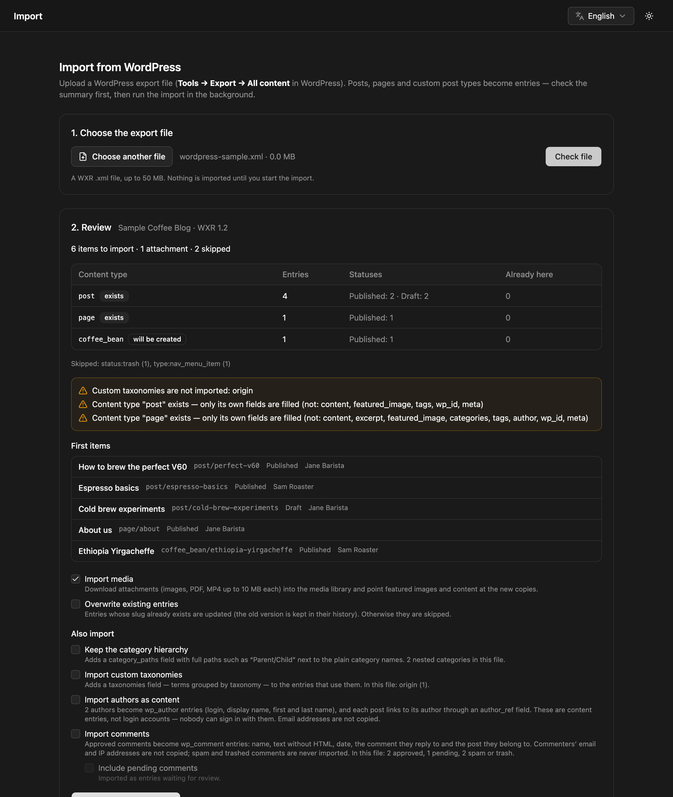

The WordPress importer reads a WordPress export file (WXR) and turns posts, pages and custom post types into NodePress entries. Fields built with Advanced Custom Fields (ACF) become real NodePress fields — flexible content, repeaters, groups, images, links — so a site built in WordPress can move over by exporting and importing one file. It can also bring over attachments, authors and comments. You check a summary first, and the import itself runs in the background.

Admins can import, under **Settings → Import**.

## 1. Export from WordPress

In WordPress, go to **Tools → Export**, choose **All content** and download the file. The importer accepts one `.xml` file up to 50 MB. For a larger site, export post types separately and import the files one after another.

## 2. Check the file

Choose the file and click **Check file**. Nothing is imported yet. The review shows:

- each content type the import will write to, and whether it **exists** or **will be created**;
- how many entries each gets, by status, and how many are **Already here**;
- the number of attachments, and what will be skipped and why;
- the first few items.



## 3. Choose options and start

| Option | What it does |
|---|---|
| **Import media** | Downloads attachments (JPEG, PNG, GIF, WebP, SVG, PDF and MP4, up to [`MEDIA_MAX_MB`](/reference/environment-variables/) each — 10 MB unless you raise it) into the media library, in a folder named "WordPress import". Featured images, ACF image fields and every link to a file — in the content and in custom fields, including WordPress's resized copies such as `photo-300x200.jpg` — then point at the new copies. Without it, entries keep pointing at the files on your WordPress site. |
| **Overwrite existing entries** | Updates entries whose slug already exists (their previous content is kept in their [version history](/content/versions/)). Without it they're skipped. |
| **Keep the category hierarchy** | Adds a `category_paths` field with full paths such as `Parent/Child`, next to the plain category names. |
| **Import custom taxonomies** | Adds a `taxonomies` field, `{ "taxonomy": ["term", …] }`, to entries that use custom taxonomies. |
| **Import authors as content** | Creates a `wp_author` entry per author (login, display name, first and last name) and links each post to it through an `author_ref` field. These are content entries, not login accounts. Email addresses aren't copied. |
| **Import comments** | Creates a `wp_comment` entry per approved comment: author name, text without HTML, date, the comment it replies to and the post it belongs to. Commenters' email and IP addresses aren't copied. |
| **Include pending comments** | With comments: also imports pending comments, as entries waiting for review. |

Click **Start import**. The page follows the job's progress (media first, then entries) and shows the result per content type: created, updated, skipped and failed, plus any problems.

## What gets imported

### Content types

Each WordPress post type becomes a content type with the same name: `post`, `page`, `product`… A post type whose name NodePress reserves for its own routes (such as `media`) gets a `wp_` prefix.

A content type that doesn't exist yet is created with these fields:

| Field | Type | From WordPress |
|---|---|---|
| `title` | text (required) | The title |
| `content` | rich text | The post content (HTML) |
| `excerpt` | textarea | The excerpt |
| `featured_image` | image | The featured image, with its alt text |
| `categories` | JSON | Category names |
| `tags` | JSON | Tag names |
| `author` | text | The author's display name |
| `wp_id` | number | The WordPress post ID |
| `meta` | JSON | Custom fields that aren't ACF fields (ACF fields get real fields, below). Keys starting with `_` (WordPress and plugin internals) are left out. |

If the content type already exists, it keeps its own schema, and only the fields it has are filled. Values are fitted to that schema — a number stored as text becomes a number, a choice the field doesn't offer is dropped — so an entry is never refused for its data.

### Advanced Custom Fields

WordPress exports include ACF's field groups, so the importer knows what every value means. Each field group shown on a post type (by its location rules) adds its fields to that content type:

| ACF field | NodePress field |
|---|---|
| Text, Text area, WYSIWYG, URL, Email, oEmbed | text, textarea, rich text |
| Number, Range | number |
| True / False | boolean |
| Select, Checkbox, Radio, Button group | select (multiple when ACF allows several) |
| Image | image (`{ url, alt }`) |
| File | text (the file's URL) |
| Gallery | repeater of images |
| Link | group: `title`, `url`, `target` |
| Date picker, Date time picker | date, date-time |
| Color picker | color |
| Post object, Page link, Relationship | relation to the imported entries, when they all point at one post type; otherwise JSON with each linked post's type, slug and title |
| Group, Clone | group |
| Repeater | repeater |
| Flexible content | flexible content: each ACF layout becomes a layout, each row a section |
| Taxonomy, User, Google Map, anything else | JSON |

- Tabs, messages and accordions only arrange ACF's editing screen, so they're left out.
- Containers nested deeper than NodePress allows (three levels) are stored as JSON, so nothing is lost.
- A field group shown on an **options page** becomes its own content type, named after the page. WordPress doesn't export options values, so it starts empty; fill it in the admin.
- A flexible field in which one layout is used more than once gets a [section key](/content-modeling/nested-fields/#section-keys) on each of those sections: `real_magic`, `real_magic_2`… You can rename them afterwards.
- Sites whose ACF fields are registered in theme code (PHP or local JSON) have no field groups in the export. Their values are still structured from the meta key names (`sections_0_heading` → `sections[0].heading`) and kept in `meta`.

### Entries

- The slug is the WordPress slug, or made from the title. When two items in the file share a slug, the second gets its WordPress ID appended, and the review lists it as a warning.
- The entry's date is the WordPress publish date.
- Entries are created in the default language.
- Entries go through the same validation as entries written in the admin.

| WordPress status | NodePress status |
|---|---|
| Published | `published` |
| Pending | `pending_review` |
| Draft | `draft` |
| Scheduled | `draft`, with a scheduled publish time, so it publishes itself at the same time |
| Private | `draft` (NodePress has no private entries) |
| Trash, auto-draft | skipped |

WordPress internals are skipped: revisions, menu items, block patterns and templates, global styles, custom CSS, WooCommerce orders and similar. ACF field definitions are read to build the fields, not imported as entries.

## Running it again

An import isn't retried automatically. If one stops halfway, for example because the server restarted, run it again from **Developer → Jobs**, or upload the file again: entries that were already imported are skipped (or updated, with **Overwrite existing entries**), and media imported before is reused.

An entry whose slug is taken by an entry in the trash fails with a message. Restore or purge the trashed entry, then import again.

:::note[Several backend servers]
The uploaded file waits in `uploads/.cache/imports` until the job runs, and the job can run on any backend server. With more than one server, `uploads/` must be shared between them, or the job fails with a message saying the file is missing. Uploaded files of failed or abandoned imports are removed after 7 days.
:::

## Safety

- The importer reads the XML with its own parser, which refuses files that declare entities or a DTD, so a crafted file can't read server files or exhaust memory.
- Attachments are downloaded only from public internet addresses, never from private or internal networks, with a size limit and a timeout per file. Each file's type is checked from its content, and SVGs are [cleaned](/content/media/#svg) like any upload.

## API

| Method | Path | What |
|---|---|---|
| `POST` | `/api/import/wordpress` | Upload the file as multipart field `file`. With `?dryRun=true` it returns the review; otherwise it queues the import and returns `{ "jobId": 12, "status": "pending", "total": 250 }`. |
| `GET` | `/api/import/wordpress/:jobId` | The job's `status` (`pending`, `running`, `done`, `failed`), `progress`, `result` and `error` |

Options are query parameters set to `true`: `importMedia`, `overwrite`, `categoryPaths`, `taxonomies`, `authors`, `comments`, `pendingComments`.

```bash
curl -X POST "https://cms.example.com/api/import/wordpress?importMedia=true&authors=true" \
  -H "Authorization: Bearer $TOKEN" \
  -F "file=@wordpress-export.xml"
```

Both endpoints are for admins only.
