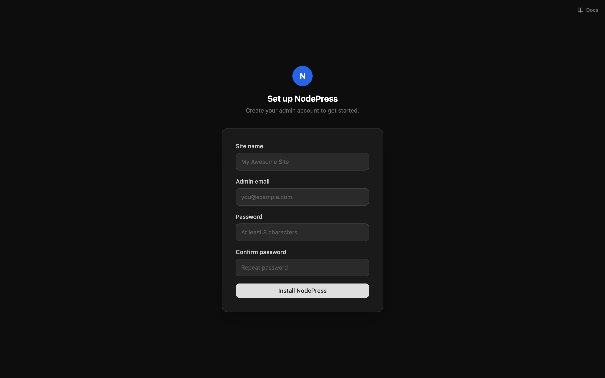

This guide puts NodePress on a Linux server you rent (a VPS) with automatic HTTPS. It takes about 20 minutes, most of it waiting. You copy and paste every command; no programming is needed.

The installer uses Docker to set everything up, but you don't need to know Docker: you install it with one command in step 4 and never touch it again. If you'd rather not use Docker, follow [Deploy on a server without Docker](/deployment/deploy-vps-node/) instead.

You'll end up with the database, API and admin all on one server, at `https://cms.example.com` (use your own domain wherever this guide says `cms.example.com`).

## 1. Create the server

At any VPS provider — DigitalOcean (Droplet), Hetzner Cloud, AWS Lightsail, Linode, Vultr — create a server with:

| Setting | Choose |
|---|---|
| Operating system | **Ubuntu 24.04 LTS** (or 22.04) |
| Memory | **2 GB or more** (1 GB works only with swap, see [step 4](#4-install-docker)) |
| Disk | 25 GB or more; uploads are stored here |
| Region | Close to the people who'll use the admin |
| Login | An SSH key if you have one, otherwise a root password |
| Backups | Turn on the provider's automatic backups if offered; it's the easiest safety net |

When it's ready, note the server's **public IPv4 address**, such as `203.0.113.10`.

:::note[AWS Lightsail]
Lightsail blocks HTTPS until you allow it: open the instance's **Networking** tab and add a firewall rule for **HTTPS (443)**. HTTP (80) and SSH (22) are open already.
:::

## 2. Point your domain at the server

Where your domain's DNS is managed (your registrar, or Cloudflare), add a record:

| Type | Name | Value |
|---|---|---|
| `A` | `cms` (for `cms.example.com`), or `@` for the bare domain | The server's IP address |

DNS changes can take from a minute to an hour to spread. Carry on with the next steps meanwhile; the installer only needs it at the very end.

:::caution[Using Cloudflare?]
Set the record to **DNS only** (the grey cloud), not **Proxied**, so the server can get its HTTPS certificate. If you want Cloudflare's proxy later, switch it on and set Cloudflare's SSL mode to **Full (strict)**.
:::

## 3. Connect to the server

On macOS or Linux open **Terminal**; on Windows open **PowerShell**. Then:

```bash
ssh root@203.0.113.10
```

Use your server's IP. On AWS Lightsail the user is `ubuntu` instead of `root`, and some providers also offer a **Console** button that opens a terminal in the browser.

Everything from here on runs **on the server**. If you logged in as a user other than `root`, put `sudo` in front of the commands in step 4.

## 4. Install Docker

```bash
curl -fsSL https://get.docker.com | sh
```

This installs Docker and Docker Compose from Docker's official script. Check it worked:

```bash
docker compose version
```

It should print `Docker Compose version v2.24` or newer.

If you logged in as `ubuntu` (or another non-root user), let it use Docker, then log out and back in:

```bash
sudo usermod -aG docker $USER
exit
```

**Server with 1 GB of memory?** Add 2 GB of swap first. NodePress normally arrives ready-made, but if it ever has to be built on the server, 1 GB isn't enough:

```bash
fallocate -l 2G /swapfile && chmod 600 /swapfile && mkswap /swapfile && swapon /swapfile
echo '/swapfile none swap sw 0 0' >> /etc/fstab
```

**Firewall.** If the server has a firewall switched on (`ufw status` says `active`), allow web traffic:

```bash
ufw allow OpenSSH && ufw allow 80 && ufw allow 443
```

## 5. Install NodePress

Replace the domain and email, then run:

```bash
curl -fsSL https://raw.githubusercontent.com/buildwithkode/nodepress/main/scripts/install.sh \
  | DOMAIN=cms.example.com ACME_EMAIL=you@example.com bash
```

The installer:

1. downloads the latest NodePress release into a `nodepress` folder;
2. generates the secrets (login signing key, database password);
3. downloads NodePress ready-made for that release and starts the database, API, admin, nginx and Caddy;
4. waits until the API is healthy.

This usually takes a few minutes. (Releases made before ready-made images existed are built on the server instead, which takes 5–10 minutes.) When it's done you'll see:

```
✔ NodePress is running at https://cms.example.com
  Open https://cms.example.com/setup to create the admin account.
```

`ACME_EMAIL` is only used by Let's Encrypt to warn about certificate problems; you can leave it out.

## 6. Create the admin account

Open `https://cms.example.com/setup` in your browser. The first visit can take a few seconds while the HTTPS certificate is issued.



The setup wizard asks for the site name and the first admin's email and password, then offers to set up email. Setup only works once: after the first account exists, add people from **Users**.

## 7. Set up email

NodePress sends invitations, password resets and form notifications by email. In the admin open **Settings → Email & storage** and fill in the **Email** card with your provider's SMTP details:

| Provider | SMTP server | Port |
|---|---|---|
| Resend | `smtp.resend.com` | 587 |
| Brevo | `smtp-relay.brevo.com` | 587 |
| Postmark | `smtp.postmarkapp.com` | 587 |
| Amazon SES | `email-smtp.<region>.amazonaws.com` | 587 |
| Gmail (small teams) | `smtp.gmail.com` | 587, with an app password |

Click **Send test**, and save once it arrives. See [Email](/deployment/email/) for the details, including the sender address.

## 8. Uploads

Nothing to do. On a server, uploads are kept in a Docker volume that survives restarts and updates. If you'd rather keep them in S3-compatible storage (for a CDN, or to keep the server small), set it up under **Settings → Email & storage**; see [File storage](/deployment/storage/).

## 9. Backups

Use two layers:

1. **The provider's server backups** (step 1), which copy the whole server.
2. **A nightly database dump** kept on the server for 14 days. Run this once to set it up:

```bash
mkdir -p /root/backups
( crontab -l 2>/dev/null; echo '0 3 * * * cd /root/nodepress && docker compose exec -T db pg_dump -U postgres --format=custom nodepress > /root/backups/nodepress-$(date +\%F).dump && find /root/backups -name "nodepress-*.dump" -mtime +14 -delete' ) | crontab -
```

(As a non-root user, replace `/root` with your home folder, such as `/home/ubuntu`.)

Also save the generated secrets somewhere safe, once. Email and storage passwords saved in the admin are encrypted with them, so a restore needs the same secrets:

```bash
cd /root/nodepress
docker run --rm -v nodepress_secrets_data:/s -v "$PWD":/out alpine tar -czf /out/secrets.tar.gz -C /s .
```

Download `secrets.tar.gz` (for example with `scp root@203.0.113.10:/root/nodepress/secrets.tar.gz .` from your own computer) and keep it with your passwords, then delete it from the server. Copying the dumps off the server now and then is wise too. [Backups](/deployment/backups/) covers restoring.

## 10. Updating

Connect to the server and run the same install command again from the same folder (the domain is remembered, so it can be left out):

```bash
curl -fsSL https://raw.githubusercontent.com/buildwithkode/nodepress/main/scripts/install.sh | bash
```

It downloads the newest release and restarts; database changes are applied automatically. Your content, uploads and settings stay as they are. See [Upgrading](/deployment/upgrading/) before a major version.

## If something goes wrong

The installer's commands work from the `nodepress` folder. Logs are the first place to look:

```bash
cd /root/nodepress
docker compose -f docker-compose.yml -f docker-compose.https.yml logs --tail 100 backend   # or caddy, frontend, db
docker compose -f docker-compose.yml -f docker-compose.https.yml ps                        # what's running
```

| Problem | What to do |
|---|---|
| The browser shows a certificate or "not secure" error | DNS isn't pointing at the server yet, or ports 80/443 are blocked. Check with `dig +short cms.example.com` (should print the server's IP), wait a few minutes, then restart Caddy: `docker compose -f docker-compose.yml -f docker-compose.https.yml restart caddy`. On Cloudflare, use **DNS only**. |
| The installer stops with `Killed` or an out-of-memory error while building | Add swap (step 4) and run the installer again. |
| `HTTPS needs Docker Compose v2.24 or newer` | Update Docker: run the step 4 command again. |
| `The backend didn't become healthy in 5 minutes` | Read the backend log (above). Run the installer again after fixing what it reports. |
| `502 Bad Gateway` right after starting | The API is still starting; wait a minute. |
| Invitation emails don't arrive | Check **Settings → Email & storage → Send test**. Some providers block port 25; use 587. Until email works, the admin copies invite links to your clipboard. |
| Forgot the admin password | Use **Forgot password?** on the login page (needs email), ask another admin to send you an invite link from **Users**, or [reset it on the server](#reset-the-admin-password-on-the-server). |

### Reset the admin password on the server

When there's no other admin and email isn't working, set a new password directly. In the `nodepress` folder, replace the password and email and run:

```bash
HASH=$(docker compose exec -T backend node -e "process.stdout.write(require('bcrypt').hashSync(process.argv[1], 10))" 'NewPassword123')
docker compose exec -T db psql -U postgres nodepress -c "UPDATE users SET password='$HASH' WHERE email='you@example.com';"
```

It should print `UPDATE 1`. Sign in with the new password, then change it from the key icon on your row in **Users**.

When everything works, go through the [go-live checklist](/deployment/deploy/#go-live-checklist).
