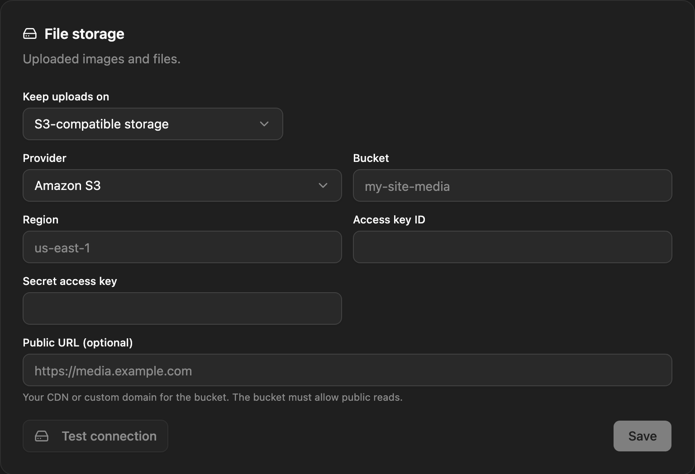

Uploaded images and files go either to the server's disk (the default) or to an S3-compatible bucket. Set it up with environment variables, or in the admin under **Settings → Email & storage**. The [Media library](/content/media/) works the same either way.

## Local disk

By default files are stored in `backend/uploads/` (the `uploads` folder in the backend's working directory) and served by the backend at `<APP_URL>/uploads/<file>`. That's fine for a single server with a persistent disk.

:::caution[Ephemeral disks]
On most managed hosts and on containers without a volume, the disk is wiped on every redeploy. The files disappear while their records in the media library stay, so every image breaks. Use S3-compatible storage there, or a persistent volume. The backend logs a warning at startup when it runs in production on local disk, and the admin shows one in **Settings → Email & storage**.
:::

Local disk also doesn't work with more than one backend instance: each instance would see only the files uploaded to it.

## S3-compatible storage

With S3 storage, each upload is streamed to the bucket, the temporary copy on the server is deleted, and the media library stores the bucket's public URL. Any service that speaks the S3 API works: AWS S3, Cloudflare R2, DigitalOcean Spaces, MinIO, Backblaze B2.

### With environment variables

```bash title="backend/.env"
STORAGE_DRIVER=s3
STORAGE_S3_BUCKET=my-bucket
STORAGE_S3_REGION=us-east-1
STORAGE_S3_ACCESS_KEY=AKIA...
STORAGE_S3_SECRET_KEY=...
# STORAGE_S3_ENDPOINT=        # not for AWS; required for R2, Spaces, MinIO, B2
# STORAGE_S3_PUBLIC_URL=      # CDN or custom domain for file URLs
```

| Variable | Required | Meaning |
|---|---|---|
| `STORAGE_DRIVER` | yes | `s3`, or `local` (the default). |
| `STORAGE_S3_BUCKET` | yes | Bucket name. |
| `STORAGE_S3_ACCESS_KEY` | yes | Access key ID. |
| `STORAGE_S3_SECRET_KEY` | yes | Secret access key. |
| `STORAGE_S3_REGION` | no | Region. Default `us-east-1`. Use `auto` for R2. |
| `STORAGE_S3_ENDPOINT` | no | The provider's S3 endpoint. Leave it empty for AWS. |
| `STORAGE_S3_PUBLIC_URL` | no | Base URL for file links, such as `https://assets.example.com`. |

With `STORAGE_DRIVER=s3` and a missing bucket, access key or secret key, the backend refuses to start and names what's missing.

### In the admin

Admins can set storage up without touching the server: in **Settings → Email & storage**, under **File storage**, choose **S3-compatible storage** in **Keep uploads on**. Pick a **Provider** (**Amazon S3**, **Cloudflare R2**, **DigitalOcean Spaces**, or **Other (MinIO, Backblaze B2…)**), which fills in the endpoint and region pattern, then enter the **Bucket**, **Access key ID**, **Secret access key** and, optionally, the **Public URL**. **Test connection** writes a small file to the bucket and deletes it again. The setup wizard offers the same form as its last step.



The secret key is stored encrypted, with a key derived from `SETTINGS_SECRET` (or `JWT_SECRET` when that isn't set). If that secret later changes, the saved key can't be read and the backend falls back to local disk, with an error in its log. Keep the secret with your backups.

### Which settings win

Storage is chosen once, when the backend starts:

1. `STORAGE_DRIVER` set in the environment: the `STORAGE_*` variables are used, and the admin's form is read-only.
2. Otherwise, the storage saved in **Settings → Email & storage**.
3. Otherwise, local disk.

A change made in the admin takes effect after a restart: use **Restart now**, which needs a [process manager](/deployment/self-hosting/#process-manager) or Docker to start the backend again. Files already uploaded aren't moved, and their URLs keep pointing where they were stored.

## File URLs

| Setup | File URL |
|---|---|
| Local disk | `<APP_URL>/uploads/<file>` |
| S3 with `STORAGE_S3_PUBLIC_URL` | `<STORAGE_S3_PUBLIC_URL>/<file>` |
| S3 with an endpoint | `<STORAGE_S3_ENDPOINT>/<bucket>/<file>` |
| AWS S3 | `https://<bucket>.s3.<region>.amazonaws.com/<file>` |

With an endpoint, NodePress uses path-style addressing. Many providers don't serve public files from their API endpoint, so set `STORAGE_S3_PUBLIC_URL` to the bucket's public or custom domain.

## Public access

Files must be publicly readable, because the media library and your site link to them directly. NodePress uploads every file with the `public-read` ACL.

:::caution[ACLs and public buckets]
- **AWS S3:** new buckets have ACLs turned off and block public access, and S3 then rejects uploads that set an ACL. Under **Object Ownership** choose **ACLs enabled** (bucket owner preferred) and allow public ACLs in the bucket's **Block public access** settings, or uploads fail.
- **Cloudflare R2** ignores ACLs. Make the bucket public yourself, through its `r2.dev` subdomain or a custom domain, and use that as `STORAGE_S3_PUBLIC_URL`.

**Test connection** writes its test file without an ACL, so it can pass while uploads still fail on ACL settings. Upload a file in the media library to be sure.
:::

## Provider examples

**Cloudflare R2**

```bash
STORAGE_DRIVER=s3
STORAGE_S3_BUCKET=my-bucket
STORAGE_S3_REGION=auto
STORAGE_S3_ENDPOINT=https://<account-id>.r2.cloudflarestorage.com
STORAGE_S3_ACCESS_KEY=...
STORAGE_S3_SECRET_KEY=...
STORAGE_S3_PUBLIC_URL=https://assets.example.com
```

**DigitalOcean Spaces**

```bash
STORAGE_DRIVER=s3
STORAGE_S3_BUCKET=my-space
STORAGE_S3_REGION=nyc3
STORAGE_S3_ENDPOINT=https://nyc3.digitaloceanspaces.com
STORAGE_S3_ACCESS_KEY=...
STORAGE_S3_SECRET_KEY=...
STORAGE_S3_PUBLIC_URL=https://my-space.nyc3.cdn.digitaloceanspaces.com
```

**MinIO**

```bash
STORAGE_DRIVER=s3
STORAGE_S3_BUCKET=nodepress
STORAGE_S3_ENDPOINT=https://minio.example.com
STORAGE_S3_ACCESS_KEY=...
STORAGE_S3_SECRET_KEY=...
```

**Backblaze B2**

```bash
STORAGE_DRIVER=s3
STORAGE_S3_BUCKET=my-bucket
STORAGE_S3_REGION=us-west-004
STORAGE_S3_ENDPOINT=https://s3.us-west-004.backblazeb2.com
STORAGE_S3_ACCESS_KEY=<keyID>
STORAGE_S3_SECRET_KEY=<applicationKey>
```

## The uploads folder with S3

Even with S3, the backend writes to `backend/uploads/`: each upload is staged there before it goes to the bucket, resized image variants are cached in `uploads/.cache`, and [WordPress imports](/content/wordpress-import/) keep the uploaded export there until the job runs. It needs to be writable, but it doesn't need to survive a redeploy. With several instances, share it if you use the WordPress importer, since the import job can run on another instance.

## Backups

The [backup script](/deployment/backups/) includes local uploads but not S3 buckets. Back a bucket up with your provider's tools, such as versioning or replication.
