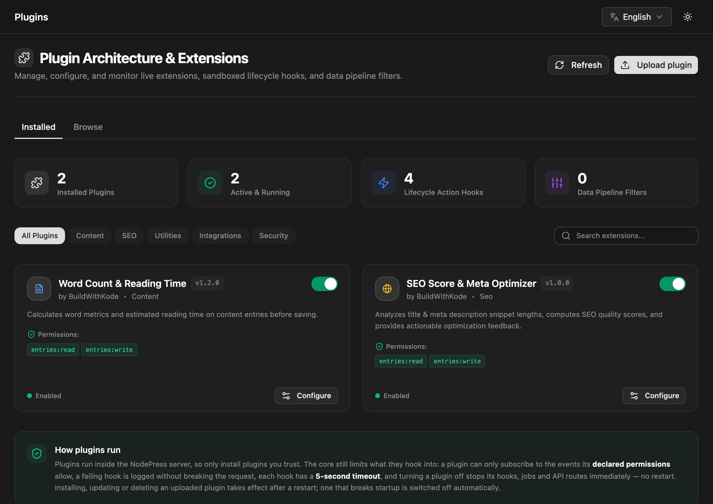

A plugin adds features to NodePress: it can react to entries being saved, change data before it's stored, reject invalid content, run background jobs and add its own API routes. Plugins run inside the NodePress server.

Only admins can manage plugins, on the **Plugins** page.

:::caution[Only install plugins you trust]
A plugin runs with full access to the server, its files and the database. Its declared permissions limit which content events it can subscribe to and are shown to you before you install, but they are not a sandbox.
:::

## Bundled plugins

These ship with NodePress and are enabled by default:

| Plugin | What it does |
|---|---|
| **Word Count & Reading Time** (`word-count`) | Before an entry is saved, counts the words of one text field and stores `_word_count` and `_reading_time_minutes` in the entry data. Settings: the field to analyze (default `content`) and the reading speed (default 200 words per minute). |
| **SEO Score & Meta Optimizer** (`seo-analyzer`) | Before an entry is saved, scores its title and description lengths and stores `_seo_score` (0–100) and `_seo_suggestions` in the entry data. Settings: minimum and maximum title and description lengths. |

Bundled plugins can be turned off and configured, but not deleted or replaced by an upload.

## The Plugins page

**Plugins** has two tabs:

- **Installed** lists every plugin on this server with its version, author, permissions and state. From here you turn plugins on and off, open their settings, and delete uploaded ones.
- **Browse** lists the plugins in the plugin directory, so you can install them.



The cards at the top count installed and active plugins and the hooks and filters they've registered.

## Turning a plugin on or off

Use the switch on the plugin's card. The change is immediate, with no restart:

- A disabled plugin's hooks stop running.
- Its queued background jobs fail with "Plugin … is disabled" instead of running.
- Its API routes answer `404`, as if it weren't installed.

The state is saved in the database and kept across restarts.

:::note[Several backend instances]
The switch and the settings take effect on the instance that handled your click. Other instances read the saved state when they start, so restart them to apply the change everywhere.
:::

A plugin that can't run here stays off and can't be turned on. Its card says why: **Incompatible** (it needs a different NodePress version) or **Not running** (it failed to load).

## Settings

Plugins with settings have a **Configure** button. Change the values and click **Save Changes**; they apply immediately, without a restart (on one instance, as noted above). Password-type settings are never sent back to the browser: the field shows they're saved, and you leave it blank to keep the value.

## Installing from the directory

The **Browse** tab shows the NodePress plugin directory, a JSON list of plugins.

- **Install** (or **Update**) downloads the package, checks it against the directory's SHA-256 checksum, and then reviews and installs it exactly like an uploaded zip, with the same signature rules.
- Plugins marked **Bundled** already ship with NodePress; turn them on in **Installed**.
- Plugins without a download link, such as paid plugins sold elsewhere, link to their homepage instead: **Get it** for paid plugins, **Learn more** for free ones.
- **Incompatible** plugins can't be installed on this NodePress version.

The server fetches the directory at most once an hour and keeps the last copy if it can't be reached. **Check again** fetches it now.

By default the directory is the `plugins-registry.json` file in the NodePress repository. Point `PLUGIN_REGISTRY_URL` at your own file to show a different list, or set it to an empty value to turn the tab off. The format is on [Publishing plugins](/extending/publishing-plugins/#the-plugin-directory).

## Uploading a plugin

Click **Upload plugin** and choose a plugin `.zip`. NodePress checks it **without running any of its code** and shows what installing it would do:

- name, version, author and the NodePress versions it works with
- the permissions it asks for, with a description of each
- whether it's signed, and by whom
- whether this is a new install, an update, a reinstall or a downgrade

<!-- screenshot: Upload plugin dialog reviewing a signed package -->

Click **Install** to store it. A new plugin is installed **disabled**; an update keeps the plugin's on/off state and settings. Packages can be at most 25 MB (`PLUGIN_MAX_UPLOAD_MB`).

Uploaded packages are stored in the database, so every server instance, including a fresh container or a redeploy, unpacks and loads them at startup. They're unpacked into `backend/.plugins` (or `PLUGINS_DIR`).

## Restarting to load changes

Installing, updating or deleting an uploaded plugin takes effect **after a server restart**. Until then the card says so ("Installed — loads when the server restarts.") and the page shows **Restart needed to load plugin changes**.

Click **Restart now**. The server exits and expects a process manager to start it again: Docker, PM2, systemd or your platform's equivalent. Without one, start it yourself. With several backend instances, restart each one, for example with a rolling restart.

If an uploaded plugin breaks startup, NodePress switches it off so the next start succeeds, and its card shows the error. Upload a fixed version or delete it.

## Deleting a plugin

Turn the plugin off, then delete it from its card. Its package and settings are removed when the server restarts. Content it created stays.

Only uploaded plugins can be deleted.

## Signatures and trust

Each package can be signed by its publisher with an Ed25519 key. The review shows one of:

| Status | Meaning |
|---|---|
| **Signed by a trusted publisher** | Signed by a key in `PLUGIN_TRUSTED_KEYS` |
| **Signed by a key this server doesn't trust** | Validly signed, by an unknown key |
| **Not signed** | No signature |
| **Invalid signature** | The package was changed after signing. Always refused. |

`PLUGIN_UPLOADS` decides what's accepted:

| Value | Effect |
|---|---|
| `signed` (default) | Only packages signed by a trusted key can be installed. A stored package that isn't is also not loaded at startup. |
| `unsigned` | Any valid package can be installed; unsigned and untrusted ones show a warning |
| `off` | Uploads, directory installs and deletes are blocked. Installed plugins still load. |

To trust a publisher, add their public key to `PLUGIN_TRUSTED_KEYS` (comma-separated) and restart:

```bash title="backend/.env"
PLUGIN_UPLOADS=signed
PLUGIN_TRUSTED_KEYS=Xq3v…base64url…,7hPa…base64url…
```

Publishers create keys with `create-nodepress-app plugin keygen`; see [Publishing plugins](/extending/publishing-plugins/).

## Environment variables

| Variable | Default | Meaning |
|---|---|---|
| `PLUGIN_UPLOADS` | `signed` | `signed`, `unsigned` or `off`, as above |
| `PLUGIN_TRUSTED_KEYS` | | Comma-separated Ed25519 public keys (base64url) |
| `PLUGIN_MAX_UPLOAD_MB` | `25` | Largest package accepted |
| `PLUGINS_DIR` | `backend/.plugins` | Where uploaded packages are unpacked |
| `PLUGIN_REGISTRY_URL` | NodePress's `plugins-registry.json` on GitHub | The directory shown under **Browse**; empty turns it off |

## API

All routes need an admin JWT, except the two read routes that editors may also call.

| Method | Path | What it does |
|---|---|---|
| `GET` | `/api/plugins` | Installed plugins and their state. Editors get it too, without settings. |
| `GET` | `/api/plugins/:id` | One plugin (admin and editor) |
| `GET` | `/api/plugins/hooks` | Registered hooks and filters (admin and editor) |
| `PATCH` | `/api/plugins/:id/toggle` | `{ "enabled": true }` turns a plugin on or off |
| `PUT` | `/api/plugins/:id/config` | Saves settings (a key/value object) |
| `POST` | `/api/plugins/packages` | Uploads a zip (`file` form field); `?dryRun=true` only reviews it |
| `DELETE` | `/api/plugins/packages/:id` | Deletes an uploaded plugin (it must be off) |
| `POST` | `/api/plugins/restart` | Restarts this server instance |
| `GET` | `/api/plugins/registry` | The plugin directory with install state; `?refresh=true` fetches it again |
| `POST` | `/api/plugins/registry/:id/install` | Installs a plugin from the directory; `?dryRun=true` only reviews it |

Installs, updates, deletes, toggles, settings changes and restarts are recorded in the [audit log](/access-control/audit-log/).

To write your own plugin, see [Building plugins](/extending/building-plugins/).
