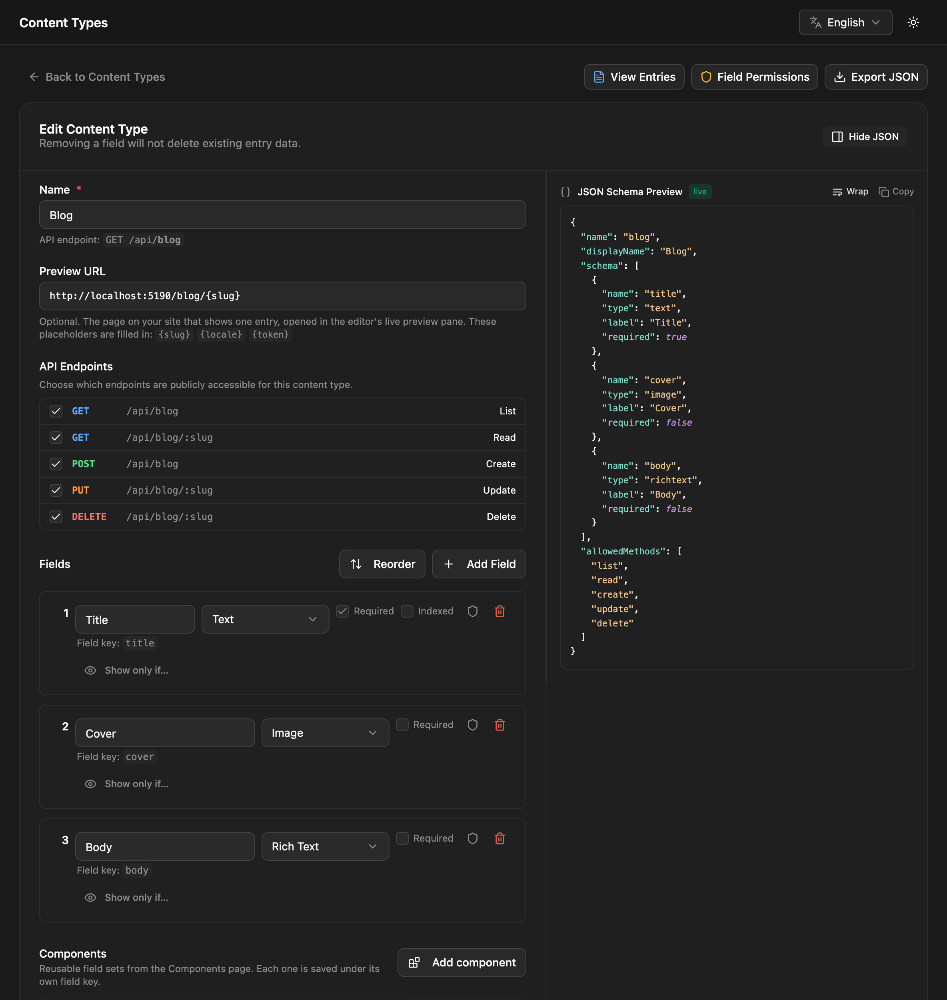
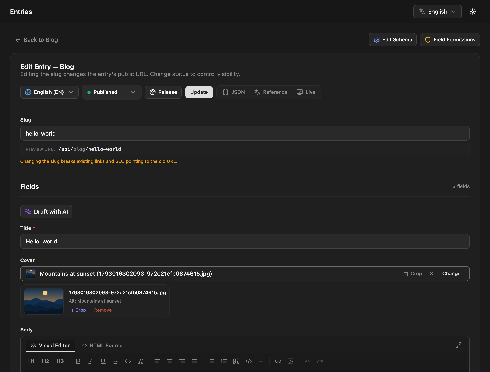

This walkthrough builds a small blog: one content type, one post, and the API call that returns it. It assumes NodePress is [installed](/getting-started/installation/) and running at http://localhost:5173.

## 1. Create a content type

A content type describes one kind of content, like a blog post or a product.

1. In the admin, open **Content Types → New Content Type**.
2. Name it `Blog`. The editor shows the API endpoint as you type: `/api/blog`.
3. Click **Add Field** and add:

   | Name | Type |
   |---|---|
   | Title | Text (tick **Required**) |
   | Cover | Image |
   | Body | Rich Text |

4. Save.



The name you type is kept as the label editors see. The **field key** used in the API is derived from it in `snake_case`, so a field named "Cover Image" is stored as `cover_image`. The editor shows each key under its field.

:::tip[Starting from scratch?]
**Start from a template** on the New Content Type page creates a ready-made blog, agency or docs site, with sample entries if you like.
:::

## 2. Write an entry

1. Open **Entries**, pick **Blog** and click **New Entry**.
2. Fill in the title, choose a cover image (upload one or pick from the media library) and write something in the body.
3. The **slug**, the entry's address, is filled in from the title: `hello-world`. You can change it.
4. Leave the status on **Published** and click **Publish**.



## 3. Read it from the API

Published entries are public, so no key is needed to read them:

```bash
curl http://localhost:3000/api/blog
```

```json
{
  "data": [
    {
      "id": "8c0f8e6e-5b1a-4a39-9d62-0f3c2b6a1d44",
      "slug": "hello-world",
      "locale": "en",
      "data": {
        "title": "Hello world",
        "cover": { "url": "http://localhost:3000/uploads/1730000000000-3f2a9c1e.jpg", "alt": "" },
        "body": "<p>My first post.</p>"
      },
      "seo": null,
      "createdAt": "2026-10-26T09:00:00.000Z",
      "updatedAt": "2026-10-26T09:00:00.000Z"
    }
  ],
  "meta": { "total": 1, "page": 1, "limit": 20, "totalPages": 1, "nextCursor": null }
}
```

Fetch one entry by its slug:

```bash
curl http://localhost:3000/api/blog/hello-world
```

Your field values are under `data`, next to the entry's own properties. `id` is the entry's permanent public ID, which stays the same if the slug changes.

## 4. Query it

The list endpoint takes filters, sorting and paging in the URL:

```bash
# Posts whose title contains "hello", newest first
curl 'http://localhost:3000/api/blog?where[title][contains]=hello&sort=createdAt:desc'

# Full-text search
curl 'http://localhost:3000/api/blog?search=first'

# Only some fields
curl 'http://localhost:3000/api/blog?fields=title,cover'
```

## 5. Use it from your site

The JavaScript client wraps the API with types:

```bash
npm install @nodepress-cms/client
```

```ts
import { createClient } from '@nodepress-cms/client';

const cms = createClient({ url: 'http://localhost:3000' });

const blog = cms.collection('blog');

const { data: posts } = await blog.list({ limit: 10 });
const post = await blog.get('hello-world');   // null if there's no such entry
```

Prefer GraphQL? The same content is at http://localhost:3000/graphql, with a type generated for each content type.

## Next steps

- [Core concepts](/getting-started/concepts/): content types, entries, statuses and locales.
- [Fields](/content-modeling/fields/): every field type and its options.
- [Nested fields](/content-modeling/nested-fields/): repeaters, groups and flexible page-builder blocks.
